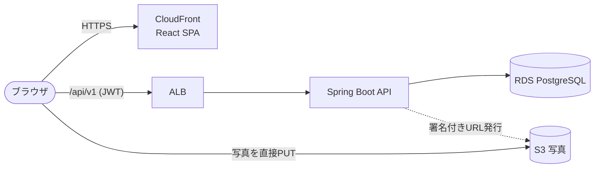

# TripDiary 🧳

旅先の思い出を写真と感想で記録し、みんなと共有できる **旅行記録・SNSアプリ** です。
自分だけの旅の記録帳として使いながら、他のユーザーの投稿から「次に行きたい場所」を見つけられます。

> 🚧 現在は **開発初期** です。プロジェクトの土台（バックエンド・フロントエンド・DB・CI）を整備し、これから機能を順に実装していきます。

---

## ✨ 主な機能

| # | 機能 | 概要 | ドキュメント |
| --- | --- | --- | --- |
| 1 | ユーザー認証 | 新規登録・JWT ログイン・トークン更新・ログアウト | [01_auth.md](docs/features/01_auth.md) |
| 2 | スポット投稿 | 旅行スポットの記録（タイトル・場所・エリア・感想・写真）の作成・閲覧・編集・削除 | [02_spot.md](docs/features/02_spot.md) |
| 3 | 写真アップロード | S3 署名付きURLを使った写真の直接アップロード | [03_photo_upload.md](docs/features/03_photo_upload.md) |
| 4 | 行ってみたい！ | 気になるスポットへのいいね | [04_like.md](docs/features/04_like.md) |
| 5 | コメント | スポットへのコメント投稿・編集・削除 | [05_comment.md](docs/features/05_comment.md) |
| 6 | フォロー | ユーザーのフォロー / フォロワー、フォロー中タイムライン | [06_follow.md](docs/features/06_follow.md) |
| 7 | エリア検索 | エリアタグ（地方 → 都道府県）による絞り込み検索 | [07_area_search.md](docs/features/07_area_search.md) |
| 8 | ステータス管理 | スポットを「訪問済み」「行きたい」リストで管理 | [08_spot_status.md](docs/features/08_spot_status.md) |

---

## 🛠 技術スタック

| 分類 | 技術 |
| --- | --- |
| フロントエンド | React 19 / TypeScript / Vite / Tailwind CSS v4 / shadcn/ui / React Router / TanStack Query / React Hook Form + Zod |
| バックエンド | Java 21 / Spring Boot 4 / Gradle / Spring Security（JWT）/ Spring Data JPA / Flyway |
| API 仕様 | springdoc-openapi（Swagger UI: `/swagger-ui/index.html`） |
| データベース | PostgreSQL 16 |
| インフラ | AWS（ALB / ECS Fargate※ / RDS / S3 / CloudFront / CloudWatch Logs / Secrets Manager） |
| ログ | Logback + Spring Boot 構造化ログ（JSON・MDC） |
| Lint / Format | Spotless（BE）/ oxlint + Prettier（FE） |
| テスト | JUnit 5 / Mockito / Testcontainers / Vitest / React Testing Library / MSW / Playwright / k6 |
| CI | GitHub Actions |

※ API の実行基盤は仮置きです。詳細は [アーキテクチャ設計書](docs/architecture.md) を参照してください。

### システム構成（概要）



---

## 📚 ドキュメント

### 設計書

| ドキュメント | 内容 |
| --- | --- |
| [要件定義書](docs/requirements.md) | 機能要件・非機能要件・画面一覧・API 概要 |
| [アーキテクチャ設計書](docs/architecture.md) | スキル図（技術スタック）・AWS 構成図・ログ設計・CI/CD |
| [DB 設計書](docs/database_schema.md) | テーブル定義・制約・インデックス・DDL |
| [ER 図](docs/er_diagram.md) | Mermaid による ER 図 |
| [品質チェック・テスト計画書](docs/qa_test_plan.md) | テスト方針・観点・カバレッジ目標・負荷テスト計画 |
| [負荷テスト結果報告書](docs/perf_test_report.md) | 負荷テストの結果（2026-11-11、全シナリオ合格）と所見 |
| [開発ルール規約](docs/rules.md) | Git 運用・コーディング・API・ログ・テスト規約 |

### 機能別ドキュメント

[docs/features/](docs/features/) に機能ごとの仕様（ユースケース・画面・API・業務ルール・エラー・テスト観点）をまとめています。

---

## 📁 ディレクトリ構成

```
TripDiary/
├── README.md
├── docs/                    # 設計ドキュメント
│   └── features/            # 機能別ドキュメント
├── backend/                 # Spring Boot（Gradle）
│   └── src/main/resources/db/migration/   # Flyway マイグレーション
├── frontend/                # React + Vite
│   ├── src/features/        # 機能単位のコード
│   └── e2e/                 # Playwright の E2E テスト
├── docker-compose.yml       # ローカル開発用（PostgreSQL）
└── .github/workflows/ci.yml # CI（Lint・単体・結合・E2E）
```

---

## 🚀 セットアップ

### 必要なもの

| ツール | バージョン |
| --- | --- |
| Java（JDK） | 21 |
| Node.js | 24 |
| Docker（Docker Desktop） | 最新版（結合テストの Testcontainers でも使用） |

Gradle は同梱の Gradle Wrapper（`./gradlew`）を使うため、インストール不要です。

### 起動手順

```bash
# 1. PostgreSQL と S3Mock（写真の保存先。S3 のローカル代替）を起動
docker compose up -d

# 2. バックエンドを起動（http://localhost:8080）
cd backend
./gradlew bootRun --args='--spring.profiles.active=local'

# 3. フロントエンドを起動（別のターミナルで / http://localhost:5173）
cd frontend
npm install
npm run dev
```

画面右上に「API: 正常」と表示されれば、フロントエンド → バックエンド → DB までつながっています。

| URL | 内容 |
| --- | --- |
| http://localhost:5173 | 画面（Vite 開発サーバー。`/api` はバックエンドへプロキシ） |
| http://localhost:8080/swagger-ui/index.html | API 仕様書（Swagger UI） |
| http://localhost:8080/actuator/health | ヘルスチェック |
| http://localhost:9090/tripdiary-photos/{s3Key} | アップロードした写真（S3Mock） |

### テスト・Lint

```bash
# バックエンド（Spotless・単体・結合・カバレッジ判定をまとめて実行。Docker が必要）
cd backend
./gradlew check
./gradlew spotlessApply      # フォーマットを自動修正
./gradlew test               # 単体テストのみ
./gradlew integrationTest    # 結合テストのみ（Testcontainers）

# フロントエンド
cd frontend
npm run lint                 # oxlint
npm run format               # Prettier で自動整形
npm run typecheck            # 型チェック
npm run test:coverage        # 単体テスト + カバレッジ
npm run e2e                  # E2E（バックエンドと DB を起動しておくこと）
```

---

## 🤝 開発ルール（抜粋）

詳細は [開発ルール規約](docs/rules.md) を参照してください。

- 作業は必ず `feature/*` / `fix/*` / `docs/*` などのトピックブランチで行います。
- Pull Request の作成までは誰でも行えますが、**`main` へのマージは開発者がレビューしたうえで手動で行います**（自動マージは禁止）。
- 機能を実装するたびに単体テスト・結合テストを作成し、**オールグリーンを確認してから** PR を作成します。
- CI（GitHub Actions）で単体・結合・E2E テストを自動実行します。**負荷テストは全機能完成時に1回だけ手動で実施します。**
- コミットメッセージは [Conventional Commits](https://www.conventionalcommits.org/ja/v1.0.0/) 形式（例: `feat(spot): スポット投稿APIを追加`）。
