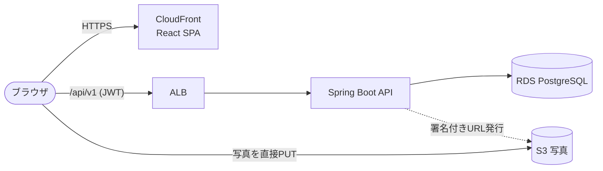

# TripDiary 🧳

旅先の思い出を写真と感想で記録し、みんなと共有できる **旅行記録・SNSアプリ** です。
自分だけの旅の記録帳として使いながら、他のユーザーの投稿から「次に行きたい場所」を見つけられます。

> ✅ 下の **12の機能はすべて実装済み** です（単体・結合・E2E テストと、負荷テスト（[結果報告書](docs/perf_test_report.md)）を実施済み）。
>
> 👤 採用担当者・面接官の方へ: ログイン画面の **「ゲストとしてログイン（採用担当者様用）」** を押すと、会員登録なしでサンプルデータの入ったアカウントから全機能を試せます。設計の考え方は [設計意図・技術選定の背景](#-設計意図技術選定の背景) からお読みいただけます。

---

## 💡 主に工夫した点（3選）

### ① ワンクリック・ゲストログインと `motion` による UX/UI 改善

- 登録不要で、投稿・フォロー・コミュニティ参加などのデータを持つサンプルユーザーとしてすぐにログインできます。専用の抜け道は作らず通常のログイン処理を使い、複数の方が使うアカウントのため **パスワード変更はサーバー側で 403 として拒否** しています。
- `motion` で、トグルボタンをタップした瞬間に弾む動き・カードのホバー・一覧のフェードインを付け、操作の手応えを伝えています。動きの値は1か所にまとめて画面ごとのばらつきをなくし、OS の「視差効果を減らす」設定も尊重しています。

### ② 既存機能と両立させた、お寺特化の5段階評価・コミュニティ機能の DB 設計

- お寺の評価（4項目×5段階）と特徴タグは、新しいテーブルを作らず **既存の `spots` に任意の列を足す** 形にしました。お寺以外の旅行記録はこれまでどおり投稿でき、いいね・コメント・検索などの既存機能はそのまま両方の投稿に使えます。
- テーマ別コミュニティは、ユーザーとコミュニティを **中間テーブル `community_members`（複合主キー）で多対多** に結び、コミュニティ内のトピックは既存の掲示板テーブルに `community_id` を足して返信・削除の仕組みを再利用しています。

### ③ 自動テスト・AWS 本番環境・Swagger による品質と運用への意識

- JUnit / Testcontainers（本物の PostgreSQL）・Vitest / MSW・Playwright の3層のテストを GitHub Actions で PR ごとに実行し、k6 の負荷テストで見つかった遅い検索を 385ms → 0.1ms に改善しました。
- AWS（ALB / ECS Fargate / RDS / S3 / CloudFront）を Terraform で構築して動作確認し、API 仕様は Swagger UI で自動生成しています。

---

## ✨ 主な機能

| # | 機能 | 概要 | ドキュメント |
| --- | --- | --- | --- |
| 1 | ユーザー認証 | 新規登録・JWT ログイン・トークン更新・ログアウト・ゲストログイン（登録なしで試せる） | [01_auth.md](docs/features/01_auth.md) |
| 2 | スポット投稿 | 旅行スポットの記録（タイトル・場所・エリア・感想・写真）の作成・閲覧・編集・削除 | [02_spot.md](docs/features/02_spot.md) |
| 3 | 写真アップロード | S3 署名付きURLを使った写真の直接アップロード | [03_photo_upload.md](docs/features/03_photo_upload.md) |
| 4 | 行ってみたい！ | 気になるスポットへのいいね | [04_like.md](docs/features/04_like.md) |
| 5 | コメント | スポットへのコメント投稿・編集・削除 | [05_comment.md](docs/features/05_comment.md) |
| 6 | フォロー | ユーザーのフォロー / フォロワー、フォロー中タイムライン | [06_follow.md](docs/features/06_follow.md) |
| 7 | エリア検索 | エリアタグ（地方 → 都道府県）による絞り込み検索 | [07_area_search.md](docs/features/07_area_search.md) |
| 8 | ステータス管理 | スポットを「訪問済み」「行きたい」リストで管理 | [08_spot_status.md](docs/features/08_spot_status.md) |
| 9 | お寺の評価・特徴タグ | 4項目の5段階評価（静寂さ・庭園建築・御朱印・アクセス）と特徴タグ、タグでの絞り込み | [09_temple_review.md](docs/features/09_temple_review.md) |
| 10 | お寺コミュニティ広場 | 誰でも書き込める掲示板（トピック・返信） | [10_community_board.md](docs/features/10_community_board.md) |
| 11 | 参考になった・称号 | 投稿への「参考になった」、ワンタップの「行きたい」、書き込み数に応じた称号 | [11_community_reactions.md](docs/features/11_community_reactions.md) |
| 12 | テーマ別コミュニティ | コミュニティの作成・検索・参加、メンバー同士のトピック投稿 | [12_communities.md](docs/features/12_communities.md) |

---

## 🗺 開発ロードマップ

### Phase 1：コア機能・コミュニティ基盤（実装・テスト完了）
- ユーザー認証・採用担当者様向けワンクリックゲストログイン機能
- 旅行・お寺参拝記録の投稿／閲覧／編集／削除（S3 画像アップロード対応）
- フォロー／フォロワー・フォロー中タイムライン、マイリスト（行きたい／訪問済み／行ってみたい！）
- お寺特化の5段階評価（静寂さ・庭園建築・御朱印・アクセス）＆特徴タグ機能、「参考になった」ボタン
- お寺参拝コミュニティ掲示板（一覧・検索・新規作成・トピック投稿）・テーマ別コミュニティ
- `motion` を用いたマイクロインタラクション・UX/UI 改善
- JUnit / Vitest / Playwright による自動テスト、k6 による負荷テスト（[結果報告書](docs/perf_test_report.md)）
- AWS 本番環境の構築・動作確認（現在はコスト削減のため停止中）

### Phase 2：パーソナライズ・回遊性向上機能（今後の拡張予定）
- **おすすめユーザー表示**：既存のフォロー機能を土台に、参拝スタイルや興味が近いユーザーを提案
- **「参考になった」投稿の一覧**：マイページのマイリスト（行きたい／訪問済み／行ってみたい！）に、参考になった投稿のタブを追加
- **閲覧履歴・レコメンド機能**：過去に閲覧したお寺や関連コミュニティの提案

---

## 🛠 使用技術と選定理由

| 分類 | 技術 | 選定理由（詳細は [技術選定理由](docs/tech-selection.md)） |
| --- | --- | --- |
| フロントエンド | React 19 / TypeScript / Vite / Tailwind CSS v4 / shadcn/ui / React Router / TanStack Query / React Hook Form + Zod | 部品を一覧・詳細・マイページで使い回せる。API の型を定義し、項目の追加漏れを型チェックで検出する |
| アニメーション | motion（旧 Framer Motion） | タップ・ホバー・フェードインを宣言的に書け、「視差効果を減らす」設定にも1行で対応できる |
| バックエンド | Java 21 / Spring Boot 4 / Gradle / Spring Security（JWT）/ Spring Data JPA / Flyway | 業務で広く使われ、認証・トランザクション・入力チェックがそろう。JWT でサーバーを何台にでも増やせる |
| API 仕様 | springdoc-openapi（Swagger UI: `/swagger-ui/index.html`） | コードから仕様書を自動生成するため、実装と仕様書がずれない |
| データベース | PostgreSQL 16 | 配列型・GIN / 部分インデックス・トリガー・CHECK 制約で、データの正しさと検索の速さを DB 側で担保できる |
| インフラ | AWS（ALB / ECS Fargate / RDS / S3 / CloudFront / CloudWatch Logs / Secrets Manager）/ Terraform | 定番構成を一通り経験できる。写真は署名付き URL で S3 へ直接送り、API の負荷を減らす。Terraform で作り直し・一括削除できる |
| ログ | Logback + Spring Boot 構造化ログ（JSON・MDC） | 有償 APM を使わず、requestId / userId でログを横断検索できる |
| Lint / Format | Spotless（BE）/ oxlint + Prettier（FE） | 書式の議論をなくし、CI で自動チェックする |
| テスト | JUnit 5 / Mockito / Testcontainers / Vitest / React Testing Library / MSW / Playwright / k6 | 本物の PostgreSQL での結合テスト、ネットワーク層でのモック、ブラウザでの通しテストで、本番に近い形で確認する |
| CI | GitHub Actions | PR ごとに Lint・単体・結合・E2E を自動実行。負荷テストは手動実行のみに分けて時間と費用を抑える |
| 開発支援 | Claude Code | 調査・実装・テストの相棒として使い、ブランチ運用・テスト必須・マージは開発者のみ、のルールで品質を保つ |

※ API の実行基盤は要件で未指定のため ECS Fargate を採用しました。詳細は [アーキテクチャ設計書](docs/architecture.md) を参照してください。

### システム構成（概要）



---

## 🧭 設計意図・技術選定の背景

採用担当者・面接官の方向けに、「なぜこの設計・技術にしたのか」をまとめています。

| ドキュメント | 内容 |
| --- | --- |
| [技術選定理由・UX/UI へのこだわり](docs/tech-selection.md) | React / TypeScript・motion・Spring Boot / PostgreSQL・AWS / S3・Swagger・Vitest / Playwright・GitHub Actions・Claude Code を選んだ理由と、品質・UX への活かし方（テストのモック調整を含む） |
| [アーキテクチャ設計書 7章「設計意図」](docs/architecture.md#7-設計意図) | 既存機能を壊さないお寺評価の追加、コミュニティの多対多と掲示板の再利用、ゲストログインのセキュリティ配慮 |

---

## 📚 ドキュメント

### 設計書

| ドキュメント | 内容 |
| --- | --- |
| [技術選定理由](docs/tech-selection.md) | 技術スタックの選定理由・UX/UI へのこだわり・テストの工夫 |
| [要件定義書](docs/requirements.md) | 機能要件・非機能要件・画面一覧・API 概要 |
| [アーキテクチャ設計書](docs/architecture.md) | スキル図（技術スタック）・AWS 構成図・ログ設計・CI/CD・設計意図 |
| [DB 設計書](docs/database_schema.md) | テーブル定義・制約・インデックス・DDL |
| [ER 図](docs/er_diagram.md) | Mermaid による ER 図 |
| [品質チェック・テスト計画書](docs/qa_test_plan.md) | テスト方針・観点・カバレッジ目標・負荷テスト計画 |
| [負荷テスト結果報告書](docs/perf_test_report.md) | 負荷テストの結果（2026-11-11、全シナリオ合格）と所見 |
| [開発ルール規約](docs/rules.md) | Git 運用・コーディング・API・ログ・テスト規約 |

### 機能別ドキュメント

[docs/features/](docs/features/) に機能ごとの仕様（ユースケース・画面・API・業務ルール・エラー・テスト観点）をまとめています。

---

## 📁 ディレクトリ構成

```
TripDiary/
├── README.md
├── docs/                    # 設計ドキュメント
│   └── features/            # 機能別ドキュメント
├── backend/                 # Spring Boot（Gradle）
│   └── src/main/resources/db/migration/   # Flyway マイグレーション
├── frontend/                # React + Vite
│   ├── src/features/        # 機能単位のコード
│   └── e2e/                 # Playwright の E2E テスト
├── docker-compose.yml       # ローカル開発用（PostgreSQL）
└── .github/workflows/ci.yml # CI（Lint・単体・結合・E2E）
```

---

## 🚀 セットアップ

### 必要なもの

| ツール | バージョン |
| --- | --- |
| Java（JDK） | 21 |
| Node.js | 24 |
| Docker（Docker Desktop） | 最新版（結合テストの Testcontainers でも使用） |

Gradle は同梱の Gradle Wrapper（`./gradlew`）を使うため、インストール不要です。

### 起動手順

```bash
# 1. PostgreSQL と S3Mock（写真の保存先。S3 のローカル代替）を起動
docker compose up -d

# 2. バックエンドを起動（http://localhost:8080）
cd backend
./gradlew bootRun --args='--spring.profiles.active=local'

# 3. フロントエンドを起動（別のターミナルで / http://localhost:5173）
cd frontend
npm install
npm run dev
```

画面右上に「API: 正常」と表示されれば、フロントエンド → バックエンド → DB までつながっています。

| URL | 内容 |
| --- | --- |
| http://localhost:5173 | 画面（Vite 開発サーバー。`/api` はバックエンドへプロキシ） |
| http://localhost:8080/swagger-ui/index.html | API 仕様書（Swagger UI） |
| http://localhost:8080/actuator/health | ヘルスチェック |
| http://localhost:9090/tripdiary-photos/{s3Key} | アップロードした写真（S3Mock） |

### テスト・Lint

```bash
# バックエンド（Spotless・単体・結合・カバレッジ判定をまとめて実行。Docker が必要）
cd backend
./gradlew check
./gradlew spotlessApply      # フォーマットを自動修正
./gradlew test               # 単体テストのみ
./gradlew integrationTest    # 結合テストのみ（Testcontainers）

# フロントエンド
cd frontend
npm run lint                 # oxlint
npm run format               # Prettier で自動整形
npm run typecheck            # 型チェック
npm run test:coverage        # 単体テスト + カバレッジ
npm run e2e                  # E2E（バックエンドと DB を起動しておくこと）
```

---

## 🤝 開発ルール（抜粋）

詳細は [開発ルール規約](docs/rules.md) を参照してください。

- 作業は必ず `feature/*` / `fix/*` / `docs/*` などのトピックブランチで行います。
- Pull Request の作成までは誰でも行えますが、**`main` へのマージは開発者がレビューしたうえで手動で行います**（自動マージは禁止）。
- 機能を実装するたびに単体テスト・結合テストを作成し、**オールグリーンを確認してから** PR を作成します。
- CI（GitHub Actions）で単体・結合・E2E テストを自動実行します。**負荷テストは全機能完成時に1回だけ手動で実施します。**
- コミットメッセージは [Conventional Commits](https://www.conventionalcommits.org/ja/v1.0.0/) 形式（例: `feat(spot): スポット投稿APIを追加`）。
