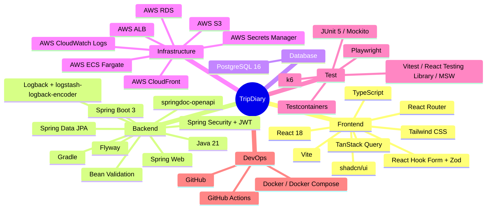
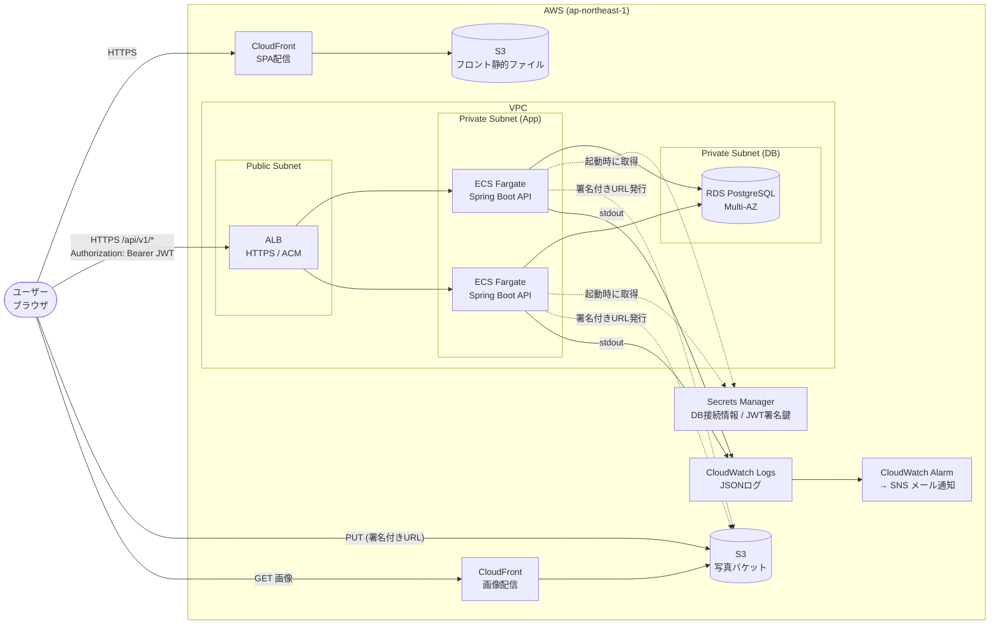
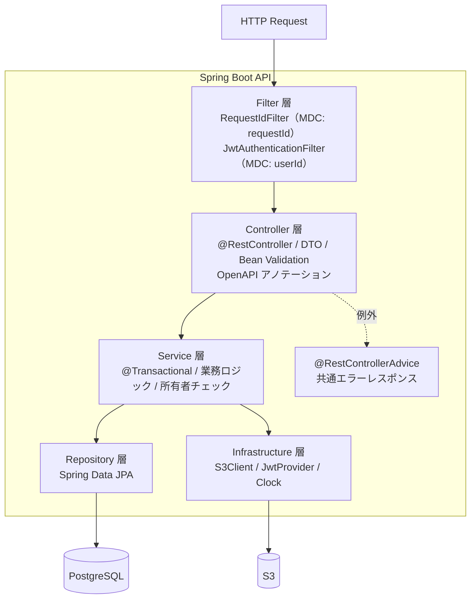
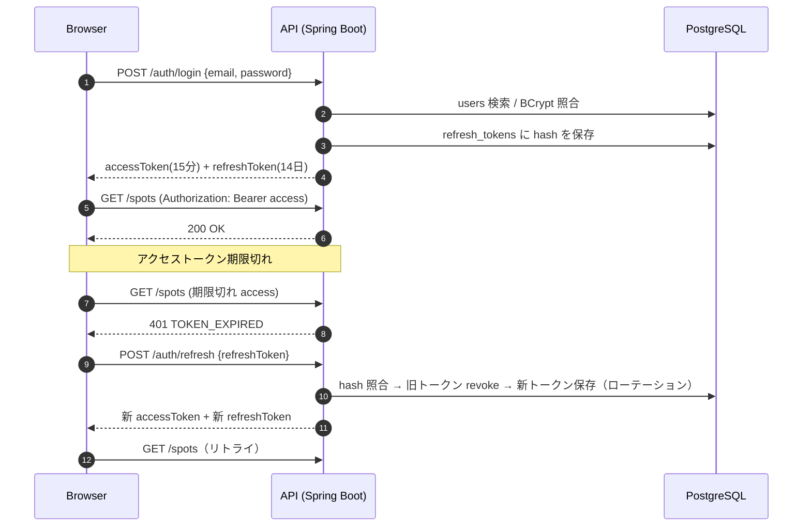
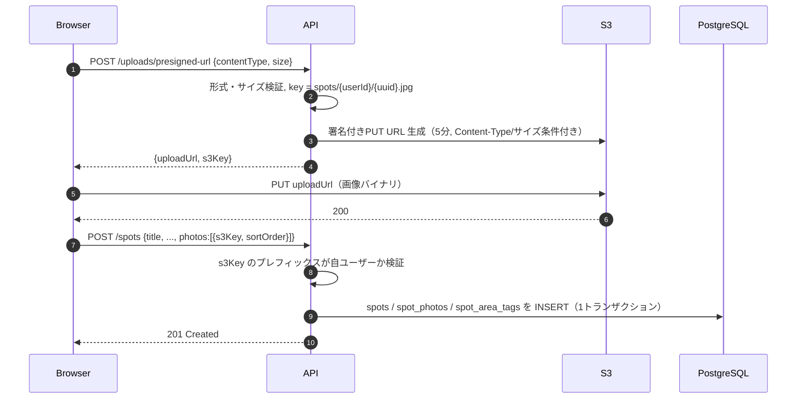
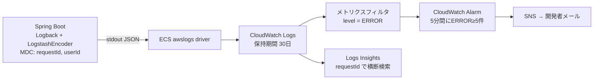
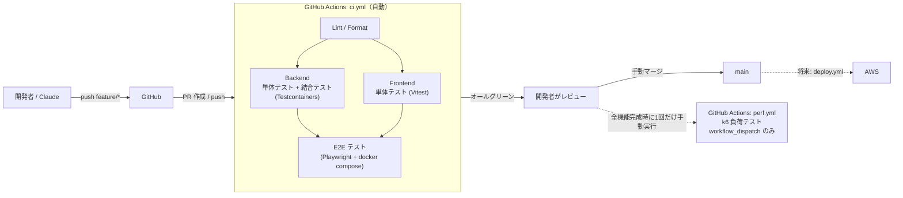

# TripDiary アーキテクチャ設計書

| 項目 | 内容 |
| --- | --- |
| ドキュメント | スキル図（技術スタック）/ アーキテクチャ図 |
| バージョン | 0.1（初版ドラフト） |
| 作成日 | 2026-11-11 |
| 関連資料 | [requirements.md](./requirements.md) / [er_diagram.md](./er_diagram.md) / [rules.md](./rules.md) / [qa_test_plan.md](./qa_test_plan.md) |

> 図はすべて Mermaid 記法。GitHub 上でそのままレンダリングされる。

---

## 1. スキル図（技術スタック）



### 1.1 技術選定一覧

| 分類 | 技術 | 用途 / 選定理由 |
| --- | --- | --- |
| 言語（FE） | TypeScript | 型安全。API レスポンス型を OpenAPI から生成可能 |
| UI | React + Vite | 高速な開発サーバー・ビルド |
| スタイル | Tailwind CSS + shadcn/ui | ユーティリティCSS + アクセシブルなコンポーネント（Radix UI ベース） |
| サーバー状態 | TanStack Query | キャッシュ・楽観的更新（いいね/フォローのトグル） |
| フォーム | React Hook Form + Zod | クライアント側バリデーション |
| 言語（BE） | Java 21 (LTS) | |
| FW | Spring Boot 3 | Web / Security / Data JPA / Actuator |
| 認証 | Spring Security + JWT（jjwt 等） | ステートレス認証。ALB 配下で水平スケール可能 |
| ORM | Spring Data JPA (Hibernate) | |
| マイグレーション | Flyway | スキーマのバージョン管理 |
| API 仕様 | springdoc-openapi | Swagger UI（`/swagger-ui/index.html`）自動生成 |
| ログ | Logback + logstash-logback-encoder | JSON 構造化ログ・MDC |
| DB | PostgreSQL 16 (RDS) | |
| 画像 | S3 + CloudFront | 署名付きURLで直接アップロード、CDN 配信 |
| 実行基盤 | ECS Fargate（※仮） | コンテナ実行。EC2 のサーバー管理を不要にする |
| CI | GitHub Actions | PR / push 時に単体・結合・E2E テスト |

> ※ API の実行基盤（ECS Fargate / EC2 / Elastic Beanstalk）は要件で未指定のため ECS Fargate を仮置きとする。

---

## 2. システム全体構成図（AWS）



| コンポーネント | 役割 | 備考 |
| --- | --- | --- |
| CloudFront + S3（Web） | React SPA の配信 | SPA ルーティングのため 403/404 を `index.html` へフォールバック |
| ALB | API の TLS 終端・負荷分散 | ヘルスチェック: `/actuator/health` |
| ECS Fargate | Spring Boot API の実行 | ステートレス。最小2タスク（本番） |
| RDS PostgreSQL | 永続データ | Private Subnet、本番は Multi-AZ・自動バックアップ7日 |
| S3（画像） | 投稿写真・アイコン | パブリックアクセスブロック有効。CloudFront OAC 経由でのみ読み取り |
| Secrets Manager | 機密情報 | DB パスワード・JWT 署名鍵 |
| CloudWatch Logs | ログ集約 | 有償 APM は使用しない（[4章](#4-ログ設計と監視)） |

---

## 3. バックエンド アプリケーション構成

### 3.1 レイヤー構成



### 3.2 パッケージ構成（機能単位パッケージ）

```
com.tripdiary
├── TripDiaryApplication.java
├── common/            # 共通: 例外, エラーレスポンス, ページング, MDCフィルタ, 設定
│   ├── config/        # SecurityConfig, OpenApiConfig, S3Config, JpaAuditingConfig
│   ├── exception/
│   ├── logging/       # RequestIdFilter, MdcUserIdFilter
│   └── web/
├── auth/              # 登録・ログイン・トークン更新 (controller/service/repository/dto)
├── user/              # プロフィール
├── spot/              # スポットCRUD・検索
├── photo/             # 署名付きURL発行・S3削除
├── area/              # エリアタグ
├── like/              # 行ってみたい！
├── comment/
├── follow/
└── status/            # 訪問済み / 行きたい
```

各機能パッケージは `XxxController` / `XxxService` / `XxxRepository` / `Xxx`（Entity）/ `dto/` で構成する。

### 3.3 フロントエンド構成

```
frontend/src
├── main.tsx / App.tsx / routes.tsx
├── components/ui/      # shadcn/ui 生成コンポーネント
├── components/         # 共通コンポーネント（Header, SpotCard, ...）
├── features/           # 機能単位: auth, spots, comments, follows, statuses, search
│   └── spots/
│       ├── api.ts      # API 呼び出し + TanStack Query hooks
│       ├── components/
│       └── pages/
├── lib/                # apiClient（JWT 付与・401 時のリフレッシュ）, utils
└── types/              # OpenAPI から生成した型
```

---

## 4. 主要フロー

### 4.1 JWT 認証フロー



> リフレッシュトークンの保存先（HttpOnly Cookie か メモリ + localStorage か）は実装フェーズで決定する。セキュリティ上は HttpOnly + Secure + SameSite Cookie を推奨。

### 4.2 写真アップロードフロー



---

## 5. ログ設計と監視

### 5.1 方針

- **Datadog 等の外部有償 APM は使用しない。** AWS 標準の CloudWatch Logs / Alarm と Spring Boot Actuator で運用する。
- 本番ログは **JSON 形式（構造化ログ）で標準出力** に出し、ECS の `awslogs` ドライバで CloudWatch Logs へ送る（アプリはファイル出力しない）。
- ローカル開発ではプロファイル `local` で人間が読みやすいテキスト形式にする。

### 5.2 ログ出力の流れ



### 5.3 ログ出力例（本番 JSON）

```json
{
  "@timestamp": "2026-11-11T03:15:42.123Z",
  "level": "INFO",
  "logger_name": "com.tripdiary.spot.SpotService",
  "thread_name": "http-nio-8080-exec-3",
  "message": "Spot created",
  "requestId": "7f3c2a1e-9b8d-4c6f-a1e2-3d4b5c6d7e8f",
  "userId": "42",
  "spotId": 1024,
  "app": "tripdiary-api",
  "env": "production"
}
```

### 5.4 MDC 設計

| キー | 設定箇所 | 内容 |
| --- | --- | --- |
| `requestId` | `RequestIdFilter`（最優先の Servlet Filter） | リクエストヘッダ `X-Request-Id` があれば採用、なければ UUID を生成。レスポンスヘッダにも返す |
| `userId` | JWT 認証フィルタの認証成功後 | 認証済みユーザーID。未認証時は付与しない |

- リクエスト終了時に `finally` で `MDC.clear()` する（スレッド再利用による汚染防止）。
- `@Async` 等の非同期処理では `TaskDecorator` で MDC を引き継ぐ。
- ログレベルの使い分け・禁止事項は [rules.md](./rules.md#5-ログ規約) を参照。

### 5.5 監視項目

| 項目 | 手段 |
| --- | --- |
| API 死活 | ALB ターゲットヘルスチェック（`/actuator/health`）+ UnHealthyHostCount アラーム |
| エラー率 | ALB の HTTPCode_Target_5XX_Count アラーム、ERROR ログのメトリクスフィルタ |
| レイテンシ | ALB の TargetResponseTime（p95）アラーム |
| DB | RDS の CPUUtilization / FreeStorageSpace / DatabaseConnections アラーム |

---

## 6. CI/CD パイプライン



| ワークフロー | トリガー | 内容 |
| --- | --- | --- |
| `ci.yml` | `pull_request`、`push`（全ブランチ） | Lint、単体テスト、結合テスト、E2E テスト |
| `perf.yml` | **`workflow_dispatch` のみ**（schedule / push / PR トリガーは設定禁止） | k6 による負荷テスト |
| `deploy.yml` | 将来検討（main へのマージ後） | ECR push → ECS デプロイ、S3 へフロント配置 |

- **main へのマージは開発者が手動で行う。** 自動マージ（auto-merge）は有効化しない。
- ブランチ保護: main は PR 必須・CI 成功必須とする。
