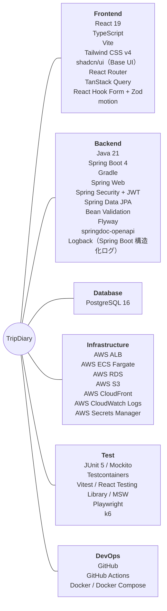
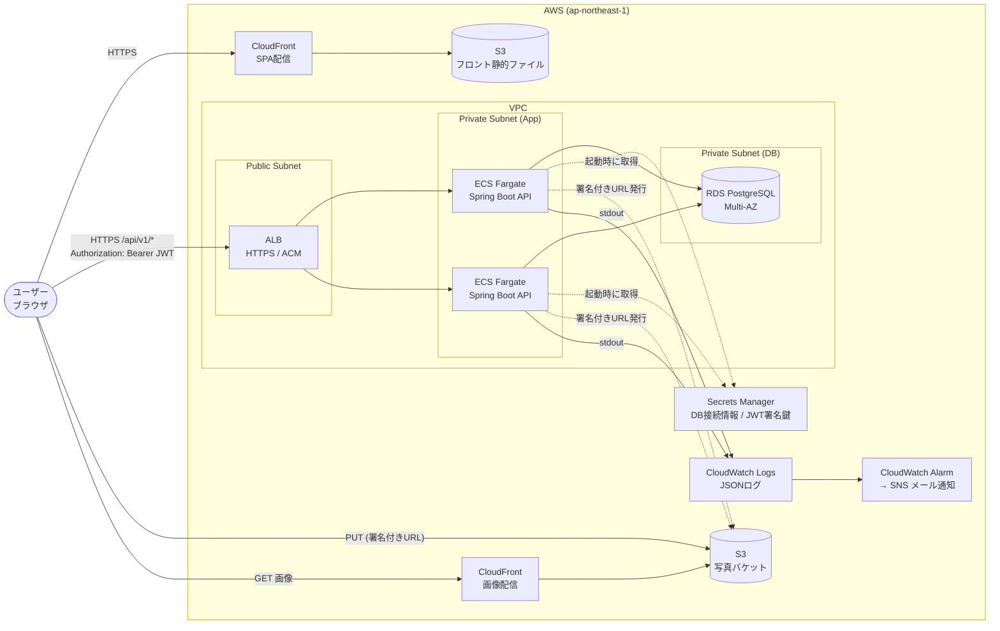
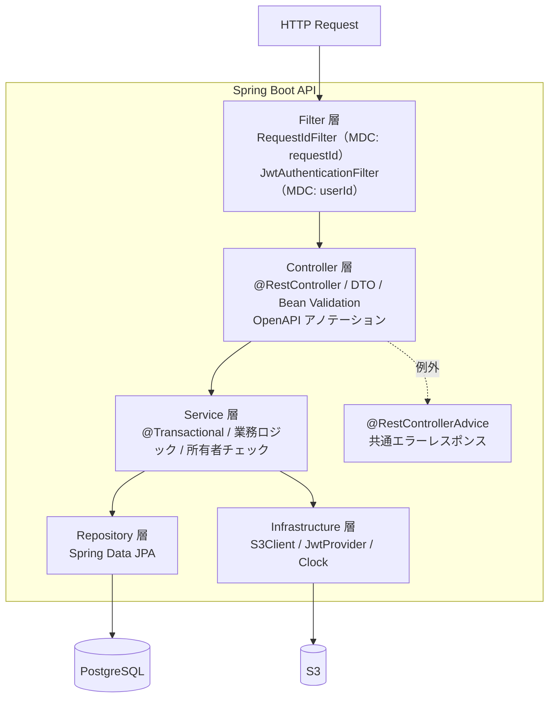
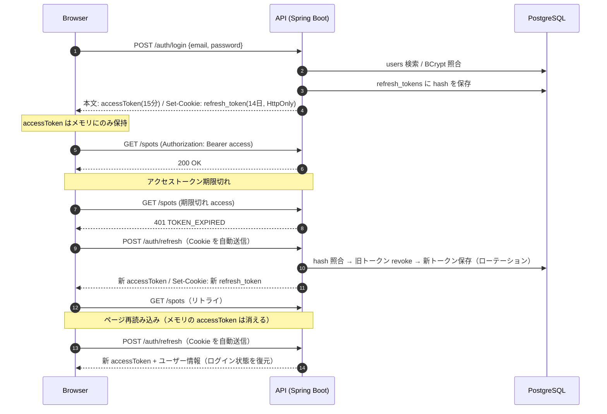
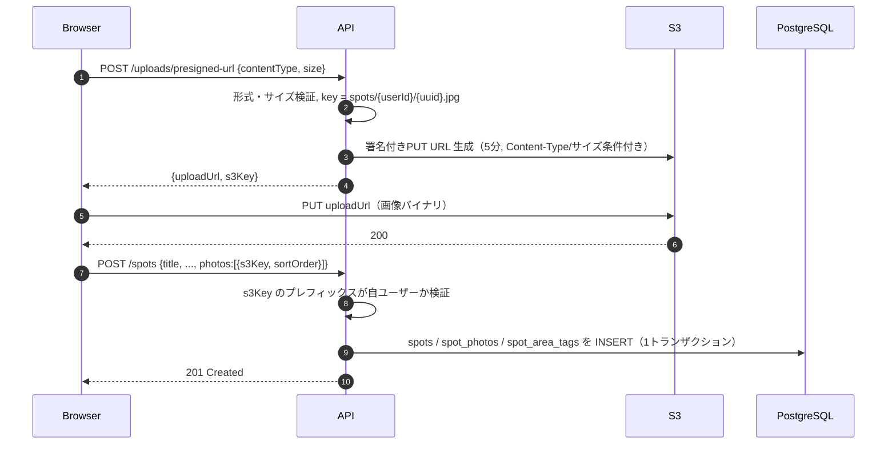
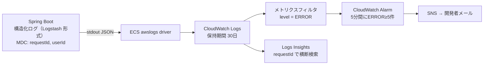
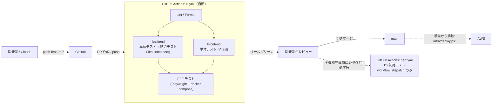
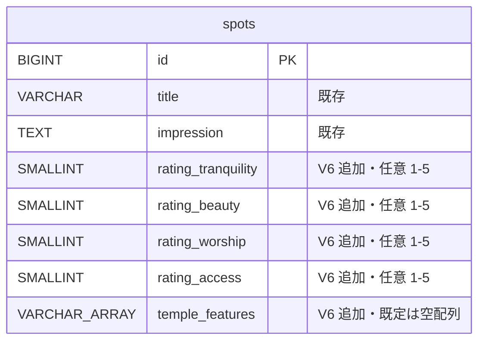
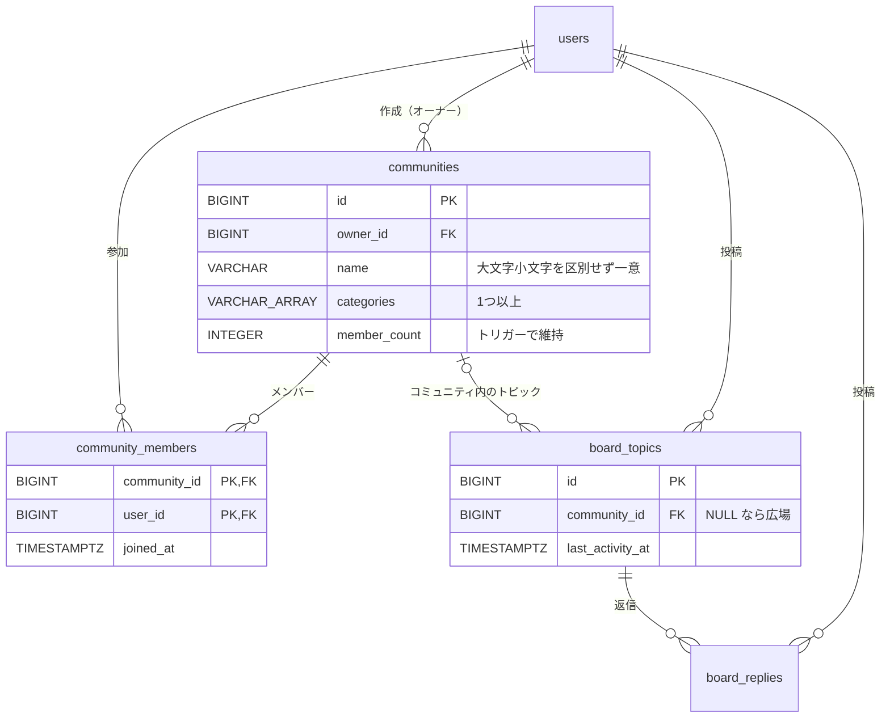
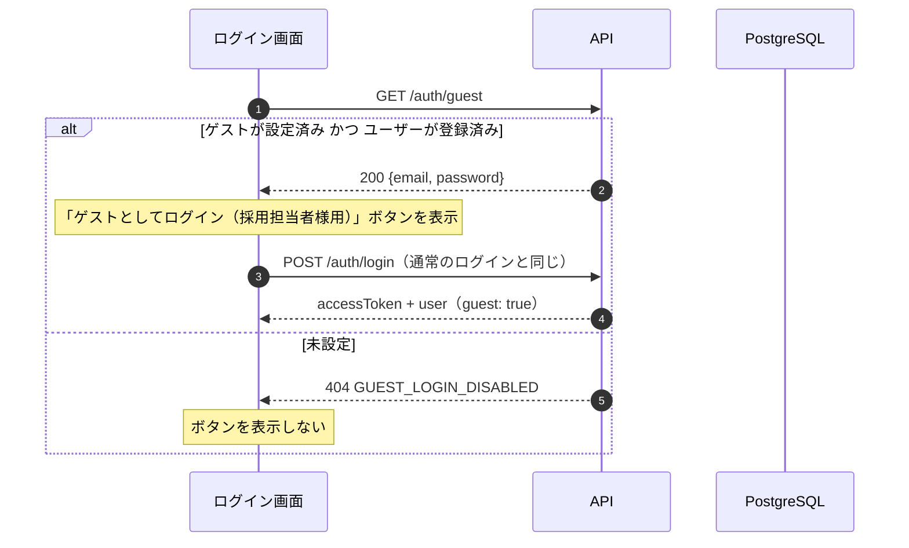

# TripDiary アーキテクチャ設計書

| 項目 | 内容 |
| --- | --- |
| ドキュメント | スキル図（技術スタック）/ アーキテクチャ図 / 設計意図 |
| バージョン | 0.2（7章「設計意図」を追加） |
| 作成日 | 2026-11-11（更新: 2026-11-21） |
| 関連資料 | [tech-selection.md](./tech-selection.md)（技術選定理由）/ [requirements.md](./requirements.md) / [er_diagram.md](./er_diagram.md) / [rules.md](./rules.md) / [qa_test_plan.md](./qa_test_plan.md) |

> 採用担当者・面接官の方へ: データ設計やゲストログインの考え方は [7章「設計意図」](#7-設計意図)、技術の選定理由は [tech-selection.md](./tech-selection.md) にまとめています。

> 図はすべて Mermaid 記法。GitHub 上でそのままレンダリングされる。

---

## 1. スキル図（技術スタック）



### 1.1 技術選定一覧

| 分類 | 技術 | 用途 / 選定理由 |
| --- | --- | --- |
| 言語（FE） | TypeScript | 型安全。API レスポンス型を OpenAPI から生成可能 |
| UI | React 19 + Vite | 高速な開発サーバー・ビルド |
| ルーティング | React Router | SPA の画面遷移 |
| スタイル | Tailwind CSS v4 + shadcn/ui | ユーティリティCSS + アクセシブルなコンポーネント（Base UI ベース） |
| Lint / Format | oxlint + Prettier | oxlint は Vite 標準テンプレートの Linter。ESLint 互換ルールを高速に検査 |
| サーバー状態 | TanStack Query | キャッシュ・楽観的更新（いいね/フォローのトグル） |
| フォーム | React Hook Form + Zod | クライアント側バリデーション |
| アニメーション | motion（旧 Framer Motion） | 一覧カードの表示・ホバー、トグルボタンのタップ演出。OS の「視差効果を減らす」設定を尊重 |
| 言語（BE） | Java 21 (LTS) | |
| FW | Spring Boot 4 | Web MVC / Security / Data JPA / Actuator（3.x は OSS サポート終了のため 4.x を採用） |
| 認証 | Spring Security + JWT（jjwt 等） | ステートレス認証。ALB 配下で水平スケール可能 |
| ORM | Spring Data JPA (Hibernate) | |
| マイグレーション | Flyway | スキーマのバージョン管理 |
| API 仕様 | springdoc-openapi | Swagger UI（`/swagger-ui/index.html`）自動生成 |
| ログ | Logback + Spring Boot 構造化ログ（`logging.structured.format.console=logstash`） | 追加ライブラリなしで JSON 構造化ログ・MDC を出力 |
| DB | PostgreSQL 16 (RDS) | |
| 画像 | S3 + CloudFront | 署名付きURLで直接アップロード、CDN 配信 |
| 実行基盤 | ECS Fargate | コンテナ実行。EC2 のサーバー管理を不要にする |
| IaC | Terraform | AWS のリソースをコードで管理し、`terraform destroy` で一括削除できるようにする |
| CI | GitHub Actions | PR / push 時に単体・結合・E2E テスト |

> ※ API の実行基盤（ECS Fargate / EC2 / Elastic Beanstalk）は要件で未指定のため ECS Fargate を採用した。

---

## 2. システム全体構成図（AWS）



| コンポーネント | 役割 | 備考 |
| --- | --- | --- |
| CloudFront + S3（Web） | React SPA の配信 | SPA ルーティングのため 403/404 を `index.html` へフォールバック |
| ALB | API の TLS 終端・負荷分散 | ヘルスチェック: `/actuator/health` |
| ECS Fargate | Spring Boot API の実行 | ステートレス。最小2タスク（本番） |
| RDS PostgreSQL | 永続データ | Private Subnet、本番は Multi-AZ・自動バックアップ7日 |
| S3（画像） | 投稿写真・アイコン | パブリックアクセスブロック有効。CloudFront OAC 経由でのみ読み取り |
| Secrets Manager | 機密情報 | DB パスワード・JWT 署名鍵 |
| CloudWatch Logs | ログ集約 | 有償 APM は使用しない（[5章](#5-ログ設計と監視)） |

> 費用を抑えたデモ環境（API 1台・Single-AZ・CloudFront で画面と API を同じドメインにまとめる構成）は [deploy.md](./deploy.md) を参照。

---

## 3. バックエンド アプリケーション構成

### 3.1 レイヤー構成



### 3.2 パッケージ構成（機能単位パッケージ）

```
com.tripdiary
├── TripDiaryApplication.java
├── common/            # 共通: 例外, エラーレスポンス, ページング, MDCフィルタ, 設定
│   ├── config/        # SecurityConfig, OpenApiConfig, S3Config, JpaAuditingConfig
│   ├── exception/
│   ├── logging/       # RequestIdFilter, MdcUserIdFilter
│   └── web/
├── auth/              # 登録・ログイン・トークン更新 (controller/service/repository/dto)
├── user/              # プロフィール
├── spot/              # スポットCRUD・検索・お寺の評価と特徴タグ
├── photo/             # 署名付きURL発行・S3削除
├── area/              # エリアタグ
├── like/              # 行ってみたい！
├── helpful/           # 参考になった
├── comment/
├── follow/
├── status/            # 訪問済み / 行きたい
├── board/             # お寺コミュニティ広場（掲示板のトピック・返信）
└── community/         # テーマ別コミュニティ（作成・参加・メンバー）
```

各機能パッケージは `XxxController` / `XxxService` / `XxxRepository` / `Xxx`（Entity）/ `dto/` で構成する。

### 3.3 フロントエンド構成

```
frontend/src
├── main.tsx / App.tsx / routes.tsx
├── components/ui/      # shadcn/ui 生成コンポーネント
├── components/         # 共通コンポーネント（Header, SpotCard, ...）
├── features/           # 機能単位: auth, spots, comments, follow, status, search, board, communities など
│   └── spots/
│       ├── api.ts      # API 呼び出し + TanStack Query hooks
│       ├── components/
│       └── pages/
├── lib/                # apiClient（JWT 付与・401 時のリフレッシュ）, utils
└── types/              # OpenAPI から生成した型
```

---

## 4. 主要フロー

### 4.1 JWT 認証フロー



> トークンの保存場所と Cookie の属性は [01_auth.md「トークンの保存場所の方針」](./features/01_auth.md#トークンの保存場所の方針) を参照。

### 4.2 写真アップロードフロー



---

## 5. ログ設計と監視

### 5.1 方針

- **Datadog 等の外部有償 APM は使用しない。** AWS 標準の CloudWatch Logs / Alarm と Spring Boot Actuator で運用する。
- 本番ログは **JSON 形式（構造化ログ）で標準出力** に出し、ECS の `awslogs` ドライバで CloudWatch Logs へ送る（アプリはファイル出力しない）。
- ローカル開発ではプロファイル `local` で人間が読みやすいテキスト形式にする。

### 5.2 ログ出力の流れ



### 5.3 ログ出力例（本番 JSON）

```json
{
  "@timestamp": "2026-11-11T03:15:42.123Z",
  "level": "INFO",
  "logger_name": "com.tripdiary.spot.SpotService",
  "thread_name": "http-nio-8080-exec-3",
  "message": "Spot created",
  "requestId": "7f3c2a1e-9b8d-4c6f-a1e2-3d4b5c6d7e8f",
  "userId": "42",
  "spotId": 1024,
  "app": "tripdiary-api",
  "env": "production"
}
```

### 5.4 MDC 設計

| キー | 設定箇所 | 内容 |
| --- | --- | --- |
| `requestId` | `RequestIdFilter`（最優先の Servlet Filter） | リクエストヘッダ `X-Request-Id` があれば採用、なければ UUID を生成。レスポンスヘッダにも返す |
| `userId` | JWT 認証フィルタの認証成功後 | 認証済みユーザーID。未認証時は付与しない |

- リクエスト終了時に `finally` で `MDC.clear()` する（スレッド再利用による汚染防止）。
- `@Async` 等の非同期処理では `TaskDecorator` で MDC を引き継ぐ。
- ログレベルの使い分け・禁止事項は [rules.md](./rules.md#5-ログ規約) を参照。

### 5.5 監視項目

| 項目 | 手段 |
| --- | --- |
| API 死活 | ALB ターゲットヘルスチェック（`/actuator/health`）+ UnHealthyHostCount アラーム |
| エラー率 | ALB の HTTPCode_Target_5XX_Count アラーム、ERROR ログのメトリクスフィルタ |
| レイテンシ | ALB の TargetResponseTime（p95）アラーム |
| DB | RDS の CPUUtilization / FreeStorageSpace / DatabaseConnections アラーム |

---

## 6. CI/CD パイプライン



| ワークフロー | トリガー | 内容 |
| --- | --- | --- |
| `ci.yml` | `pull_request`、`push`（全ブランチ） | Lint、単体テスト、結合テスト、E2E テスト |
| `perf.yml` | **`workflow_dispatch` のみ**（schedule / push / PR トリガーは設定禁止） | k6 による負荷テスト |
| `infra/deploy.ps1`（手元から手動） | 開発者が実行 | ECR push → Terraform で ECS 更新 → S3 へフロント配置。デモ環境の構成・手順は [deploy.md](./deploy.md) |

- **main へのマージは開発者が手動で行う。** 自動マージ（auto-merge）は有効化しない。
- ブランチ保護: main は PR 必須・CI 成功必須とする。

---

## 7. 設計意図

ここでは「なぜこの形にしたか」を、機能を追加したときの判断とあわせて説明する。テーブル定義の詳細は [database_schema.md](./database_schema.md)、図は [er_diagram.md](./er_diagram.md) を参照。

### 7.1 既存の旅行記録を壊さずに「お寺特化の5段階評価・特徴タグ」を追加する

TripDiary はもともと汎用の旅行記録アプリで、あとから「お寺参拝」に特化した機能を足した。そのとき **既存の投稿・API・画面をそのまま動かし続けること** を最優先にした。



| 判断 | 理由 |
| --- | --- |
| **新しいテーブルを作らず、`spots` に任意の列を足す**（[V6__temple_review.sql](../backend/src/main/resources/db/migration/V6__temple_review.sql)） | 投稿は「旅行記録」でも「お寺参拝」でも同じ1件の記録。テーブルを分けると一覧・検索・いいね・コメントなどすべての機能で2種類を扱う必要が出る。列を足すだけなら、既存の機能はそのまま両方の投稿に使える |
| **評価はすべて NULL 可（未評価）、特徴タグは既定で空配列** | お寺以外の投稿は値を持たないだけで、これまでどおり投稿できる。API でも `ratings` を省略すれば `null`、`templeFeatures` を省略すれば `[]` を返すため、既存のフロントエンド・テストを変えずに済んだ |
| **評価は項目ごとの列（4列）** | 「静寂さ・雰囲気」「庭園・建築の美しさ」「御朱印・参拝の充実度」「アクセス・駐車場の停めやすさ」は固定の4項目で、項目ごとに CHECK 制約（1〜5）をかけられる。項目ごとに平均を出す・並べ替えるといった集計も素直に書ける |
| **特徴タグは別テーブルにせず配列の列（`VARCHAR(30)[]`）** | 値は決まった5種類（御朱印あり・駐車場あり など）で、追加はアプリのリリースと一緒に行う。中間テーブルにすると一覧で投稿ごとにタグを読むクエリが増える。配列なら1行で読め、`temple_features @> ARRAY[...]`（すべてのタグを持つ投稿）を GIN インデックスで高速に検索できる |
| **値の正しさを DB でも保証** | 評価の範囲（1〜5）と特徴タグの種類を CHECK 制約で縛る。API の Bean Validation と二重にし、アプリにバグがあっても不正な値が入らない |
| **マイグレーションは追加のみ** | 既存の列は変更・削除せず、`ALTER TABLE ... ADD COLUMN` だけで済ませた。既存データの移行が不要で、デプロイ時に古いデータが壊れる心配がない |

> 将来「お寺ごとの評価の平均」を出すには、お寺をマスタとして持つ必要がある（[09_temple_review.md](./features/09_temple_review.md) の将来検討）。今は投稿単位の評価にとどめ、必要になった時点でマスタを足せる形にしている。

### 7.2 コミュニティ機能：中間テーブルによる多対多と、掲示板の仕組みの再利用

コミュニティ機能は2段階で作った。

1. **お寺コミュニティ広場**（[V7](../backend/src/main/resources/db/migration/V7__community_board.sql)）：誰でもトピックを立てて返信できる掲示板。
2. **テーマ別コミュニティ**（[V9](../backend/src/main/resources/db/migration/V9__communities.sql)）：ユーザーが「北陸・富山のお寺巡り同好会」のようなコミュニティを作り、参加したメンバー同士で話せる場所。



#### ユーザーとコミュニティの多対多（`community_members`）

| 判断 | 理由 |
| --- | --- |
| **中間テーブル `community_members`、主キーは `(community_id, user_id)`** | 1人が複数のコミュニティに参加し、1つのコミュニティに複数人が参加する多対多の関係。複合主キーにすることで、同じ人が二重に参加することを DB が防ぐ。参加 API（`PUT /communities/{id}/membership`）は冪等で、何度押しても結果は同じ |
| **両方向のインデックス** | 主キーで「コミュニティのメンバー一覧」、`idx_community_members_user_id` で「ユーザーが参加しているコミュニティ」を引ける。メンバー一覧は参加した順のカーソルページング用に `(community_id, joined_at, user_id)` のインデックスを持つ |
| **`ON DELETE CASCADE`** | コミュニティを削除すると参加関係・トピック・返信も消え、ユーザーが退会すると参加関係も外れる。アプリで消し忘れても、参加者のいない「孤立した行」が残らない |
| **オーナーも1メンバーとして登録** | 作成者は作成時に自動で参加する。「メンバーかどうか」の判定が1つのテーブルだけで済み、オーナーは退出できない（409 `OWNER_CANNOT_LEAVE`）というルールを足すだけで済んだ |
| **`member_count` をトリガーで維持** | 「メンバーが多い順」に並べるため、件数を毎回数えずに列で持つ。`community_members` の INSERT / DELETE で ±1 するトリガーにし、アプリのどこから参加・退出しても件数がずれない（いいね数 `spots.like_count` と同じ考え方） |

#### 検索

- **キーワード検索**：名前・説明文の部分一致（`ILIKE`）を、`pg_trgm` の GIN インデックスで高速化した。`%`・`_` は記号ではなく文字として扱い、入力によって意図しない検索にならないようにした。
- **カテゴリの絞り込み**：カテゴリ（地域別・御朱印・建築・庭園・初心者歓迎・写真）は、お寺の特徴タグと同じく配列の列 + GIN インデックス。
- **並び順**：新着順・人気順（メンバー数）それぞれに専用のインデックスを用意し、カーソルページング（「もっと見る」）で件数が増えても速さが落ちないようにした。
- 検索条件は URL のクエリ（`?q=富山&category=REGIONAL&sort=popular`）に持ち、共有やブラウザの戻る操作に対応する。

#### 新規作成

- 名前は1〜50文字で、**大文字・小文字を区別せず一意**（`lower(name)` のユニークインデックス）。同じ名前のコミュニティが乱立しないようにし、重複は 409 `COMMUNITY_NAME_TAKEN` で入力欄の下に表示する。
- カテゴリは1つ以上必須（CHECK 制約 `cardinality(categories) >= 1`）。一覧で探しやすくするため。

#### トピック投稿：掲示板のテーブルを再利用

| 判断 | 理由 |
| --- | --- |
| **コミュニティ内のトピックを別テーブルにせず、`board_topics` に `community_id` を足した** | 返信・削除・一覧・称号（書き込み数）の仕組みを広場とそのまま共有できる。画面も同じトピック画面を使い、コミュニティのトピックでは「← コミュニティ名」の戻り先と、返信フォームの出し分けだけを変えた |
| **`community_id IS NULL` なら広場、値があればコミュニティ内** | 既存の広場のトピックは `NULL` のまま動き、データ移行が不要 |
| **部分インデックスで一覧を分ける** | 広場の一覧は `WHERE community_id IS NULL`、コミュニティの一覧は `WHERE community_id IS NOT NULL` の部分インデックスで読む。同じテーブルに入れても、それぞれの一覧が相手のデータに邪魔されずに速く読める |
| **書き込みはメンバーのみ、閲覧は誰でも** | 内輪の話をしやすくしつつ、参加前に雰囲気を見て判断できるようにした。メンバー以外の書き込みは 403 `COMMUNITY_MEMBERSHIP_REQUIRED`。オーナーはトピック・返信を削除でき、場を整えられる |

### 7.3 ワンクリック・ゲストログイン

採用担当者・面接官が **個人情報を登録せずに、すぐ全機能を試せる** ようにした機能（[01_auth.md 4.8](./features/01_auth.md#48-ゲストログイン-get-authguest)）。



| 判断 | 理由 |
| --- | --- |
| **専用の「ゲスト用ログイン API」を作らず、通常のログインを使う** | ログインの処理・トークン発行・レート制限（総当たり対策）をそのまま使える。ゲストだけの抜け道ができず、セキュリティ上の確認範囲が広がらない |
| **ゲストはサンプルデータの実在ユーザー1人** | 空のアカウントではなく、投稿・フォロー・マイリスト・コミュニティ参加などのデータを持つユーザーでログインするため、ログイン直後から全機能を試せる |
| **設定したときだけ有効**（`app.guest.email` / `app.guest.password`、[GuestAccount.java](../backend/src/main/java/com/tripdiary/auth/GuestAccount.java)） | 本番では環境変数を入れたときだけボタンが出る。設定していない・ユーザーが未登録の環境では 404 を返し、画面にも何も出さない |
| **パスワードは公開してよいデモ用のものだけ** | 画面に表示する前提のため、秘密情報としては扱わない。個人のアカウントをゲストにしない運用にしている |

#### セキュリティ上の配慮：パスワード変更の制限

ゲストは複数の人が同時に使うアカウントのため、**1人がパスワードを変えると他の人がログインできなくなる**。そこでパスワード変更を禁止した。

- **サーバーで拒否する。** API を直接呼ばれても `403 GUEST_ACCOUNT_RESTRICTED` を返す（現在のパスワードの確認より先に判定）。画面の制御だけに頼らない。
- **画面でも分かるようにする。** `GET /users/me` が `guest: true` を返し、パスワード変更画面では理由を表示して入力欄・ボタンを無効にする。マイページにも「ゲストアカウントでログインしています」と表示する。
- **メールアドレスは変更する API がもともと無い**ため、ゲストを乗っ取られる経路はない。
- 投稿・コメント・プロフィールの編集などは試せる。データが崩れた場合はサンプルデータを入れ直す（[deploy.md 3.3](./deploy.md#33-サンプルデータ)）。
- 結合テスト（`GuestLoginIntegrationTest`）で「設定済みかつ登録済みのときだけログイン情報を返す」「ゲストは API を直接呼んでも変更できない」「他のユーザーは変更できる」を確認している。
