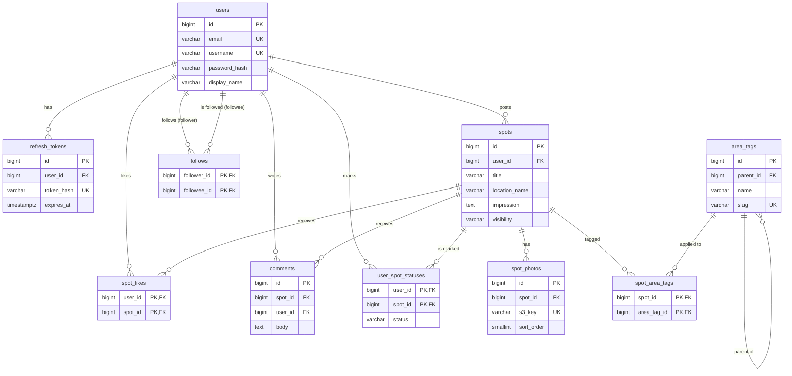

# TripDiary データベース設計書

| 項目 | 内容 |
| --- | --- |
| ドキュメント | DB設計書（テーブル定義・リレーション） |
| 対象DB | PostgreSQL 16 以上（Amazon RDS） |
| バージョン | 0.1（初版ドラフト） |
| 作成日 | 2026-11-11 |
| 関連資料 | [requirements.md](./requirements.md) |

---

## 1. 設計方針

| 項目 | 方針 |
| --- | --- |
| 命名規則 | テーブル名・カラム名は `snake_case`。テーブル名は複数形 |
| 主キー | `BIGINT GENERATED ALWAYS AS IDENTITY`（JPA: `@GeneratedValue(strategy = GenerationType.IDENTITY)`） |
| 日時 | `TIMESTAMPTZ`（UTC で保存し、表示時に JST 変換） |
| 監査カラム | 主要テーブルに `created_at` / `updated_at` を持つ。`updated_at` は JPA の `@PreUpdate`（または Spring Data Auditing）で更新 |
| 列挙値 | PostgreSQL の ENUM 型ではなく `VARCHAR` + `CHECK` 制約で表現（JPA `@Enumerated(EnumType.STRING)` との相性、値追加時のマイグレーション容易性のため） |
| 文字列 | 長さ上限のある項目は `VARCHAR(n)`、長文は `TEXT` + `CHECK (char_length(...) <= n)` |
| 削除方式 | 初期リリースは物理削除。子テーブルは `ON DELETE CASCADE` で整合性を保つ |
| 多対多 | 中間テーブルは複合主キーを使用（JPA: `@EmbeddedId`） |
| マイグレーション | Flyway（`src/main/resources/db/migration/V1__init.sql` 〜） |

---

## 2. ER 図

> 全カラム・機能別ビューを含む詳細な ER 図は [er_diagram.md](./er_diagram.md) を参照。以下は主要カラムのみの概略。



### テーブル一覧

| No | テーブル名 | 論理名 | 対応機能 |
| --- | --- | --- | --- |
| 1 | `users` | ユーザー | 認証・プロフィール |
| 2 | `refresh_tokens` | リフレッシュトークン | JWT認証 |
| 3 | `spots` | スポット（投稿） | 投稿CRUD |
| 4 | `spot_photos` | スポット写真 | S3アップロード |
| 5 | `area_tags` | エリアタグ（マスタ） | 絞り込み検索 |
| 6 | `spot_area_tags` | スポット×エリアタグ | 絞り込み検索 |
| 7 | `spot_likes` | 行ってみたい！ | いいね |
| 8 | `comments` | コメント | コメント |
| 9 | `follows` | フォロー関係 | フォロー / フォロワー |
| 10 | `user_spot_statuses` | ユーザー別スポットステータス | 訪問済み / 行きたい |

---

## 3. テーブル定義

凡例: **PK** = 主キー / **FK** = 外部キー / **UQ** = 一意制約 / **NN** = NOT NULL

### 3.1 `users`（ユーザー）

| カラム名 | 型 | 制約 | デフォルト | 説明 |
| --- | --- | --- | --- | --- |
| `id` | `BIGINT` | PK, IDENTITY | | ユーザーID |
| `email` | `VARCHAR(255)` | NN, UQ（小文字化した値で一意） | | ログイン用メールアドレス |
| `username` | `VARCHAR(30)` | NN, UQ, CHECK（`^[A-Za-z0-9_]{3,30}$`） | | URLに使うユーザー名 |
| `password_hash` | `VARCHAR(100)` | NN | | BCrypt ハッシュ |
| `display_name` | `VARCHAR(50)` | NN | | 表示名 |
| `bio` | `VARCHAR(500)` | | `NULL` | 自己紹介 |
| `avatar_s3_key` | `VARCHAR(512)` | | `NULL` | アイコン画像の S3 オブジェクトキー |
| `created_at` | `TIMESTAMPTZ` | NN | `now()` | 作成日時 |
| `updated_at` | `TIMESTAMPTZ` | NN | `now()` | 更新日時 |

インデックス:
- `uq_users_email_lower` : `UNIQUE (lower(email))` — 大文字小文字違いの重複登録を防止
- `uq_users_username_lower` : `UNIQUE (lower(username))`

### 3.2 `refresh_tokens`（リフレッシュトークン）

| カラム名 | 型 | 制約 | デフォルト | 説明 |
| --- | --- | --- | --- | --- |
| `id` | `BIGINT` | PK, IDENTITY | | |
| `user_id` | `BIGINT` | NN, FK → `users.id` ON DELETE CASCADE | | 所有ユーザー |
| `token_hash` | `VARCHAR(64)` | NN, UQ | | トークンの SHA-256 ハッシュ（16進） |
| `expires_at` | `TIMESTAMPTZ` | NN | | 有効期限 |
| `revoked_at` | `TIMESTAMPTZ` | | `NULL` | 失効日時（ログアウト・パスワード変更・再利用検知時に設定）。失効後は使えない |
| `rotated_at` | `TIMESTAMPTZ` | | `NULL` | ローテーションで使用済みにした日時（V4 で追加）。ここから猶予期間の間だけ再利用を許す（[01_auth.md](features/01_auth.md) 5章） |
| `created_at` | `TIMESTAMPTZ` | NN | `now()` | 発行日時 |

インデックス:
- `idx_refresh_tokens_user_id` : `(user_id)`

> アクセストークン（JWT）はステートレスのため DB に保存しない。期限切れ・失効済みのレコードは定期バッチで削除する。

### 3.3 `spots`（スポット投稿）

| カラム名 | 型 | 制約 | デフォルト | 説明 |
| --- | --- | --- | --- | --- |
| `id` | `BIGINT` | PK, IDENTITY | | スポットID |
| `user_id` | `BIGINT` | NN, FK → `users.id` ON DELETE CASCADE | | 投稿者 |
| `title` | `VARCHAR(100)` | NN, CHECK（`char_length(trim(title)) >= 1`） | | タイトル |
| `location_name` | `VARCHAR(200)` | NN | | 場所名（例: 「清水寺」「京都府京都市東山区」） |
| `impression` | `TEXT` | CHECK（`char_length(impression) <= 5000`） | `NULL` | 感想 |
| `visited_on` | `DATE` | | `NULL` | 訪問日 |
| `visibility` | `VARCHAR(10)` | NN, CHECK（`IN ('PUBLIC','PRIVATE')`） | `'PUBLIC'` | 公開範囲 |
| `latitude` | `NUMERIC(9,6)` | CHECK（-90〜90） | `NULL` | 緯度（将来の地図機能用） |
| `longitude` | `NUMERIC(9,6)` | CHECK（-180〜180） | `NULL` | 経度（将来の地図機能用） |
| `created_at` | `TIMESTAMPTZ` | NN | `now()` | 投稿日時 |
| `updated_at` | `TIMESTAMPTZ` | NN | `now()` | 更新日時 |

インデックス:
- `idx_spots_user_id_created_at` : `(user_id, created_at DESC)` — プロフィール・タイムライン
- `idx_spots_public_created_at` : `(created_at DESC, id DESC) WHERE visibility = 'PUBLIC'` — 新着一覧（部分インデックス）
- `idx_spots_title_trgm` / `idx_spots_location_trgm` : `GIN (title gin_trgm_ops)` 等 — キーワード部分一致検索（`pg_trgm` 拡張、SRCH-04 対応時）

> 「行ってみたい！」数・コメント数は初期リリースでは `COUNT` 集計で取得する。負荷が問題になった場合は `spots` に `like_count` / `comment_count` の非正規化カラムを追加する。

### 3.4 `spot_photos`（スポット写真）

| カラム名 | 型 | 制約 | デフォルト | 説明 |
| --- | --- | --- | --- | --- |
| `id` | `BIGINT` | PK, IDENTITY | | 写真ID |
| `spot_id` | `BIGINT` | NN, FK → `spots.id` ON DELETE CASCADE | | 所属スポット |
| `s3_key` | `VARCHAR(512)` | NN, UQ | | S3 オブジェクトキー（例: `spots/{userId}/{uuid}.jpg`） |
| `content_type` | `VARCHAR(50)` | NN, CHECK（`IN ('image/jpeg','image/png','image/webp','image/heic')`） | | MIMEタイプ |
| `sort_order` | `SMALLINT` | NN, CHECK（`0〜9`） | `0` | 表示順（0 がカバー写真） |
| `created_at` | `TIMESTAMPTZ` | NN | `now()` | 登録日時 |

制約・インデックス:
- `uq_spot_photos_spot_sort` : `UNIQUE (spot_id, sort_order) DEFERRABLE INITIALLY DEFERRED` — 並び替え時の一時的な重複を許容

> 写真URLは DB に保存せず、`s3_key` と配信ドメイン（CloudFront / S3）からアプリ側で組み立てる。ドメイン変更時にデータ移行が不要になる。1投稿10枚の上限は `sort_order` の CHECK とアプリ側バリデーションで担保する。

### 3.5 `area_tags`（エリアタグ マスタ）

| カラム名 | 型 | 制約 | デフォルト | 説明 |
| --- | --- | --- | --- | --- |
| `id` | `BIGINT` | PK, IDENTITY | | エリアタグID |
| `parent_id` | `BIGINT` | FK → `area_tags.id` ON DELETE RESTRICT | `NULL` | 親タグ（NULL = 最上位） |
| `name` | `VARCHAR(50)` | NN | | 表示名（例: 「京都」） |
| `slug` | `VARCHAR(50)` | NN, UQ, CHECK（`^[a-z0-9-]+$`） | | URL用識別子（例: `kyoto`） |
| `level` | `SMALLINT` | NN, CHECK（`1〜3`） | | 階層（1: 地方/国, 2: 都道府県/地域, 3: 市区町村など） |
| `sort_order` | `INTEGER` | NN | `0` | 表示順 |
| `created_at` | `TIMESTAMPTZ` | NN | `now()` | 作成日時 |

制約・インデックス:
- `uq_area_tags_parent_name` : `UNIQUE (parent_id, name)`
- `idx_area_tags_parent_id` : `(parent_id)`

初期データ（Flyway の `V2__seed_area_tags.sql` で投入。全体は [07_area_search.md](./features/07_area_search.md#エリアタグの階層初期データ) を参照）の例:

| parent | name | slug | level |
| --- | --- | --- | --- |
| （なし） | 関西 | kansai | 1 |
| 関西 | 京都 | kyoto | 2 |
| 関西 | 大阪 | osaka | 2 |
| （なし） | 海外 | overseas | 1 |
| 海外 | 台湾 | taiwan | 2 |

> ID は自動採番のため環境によって異なる。アプリやテストでは `slug` でタグを特定する。

> 親タグ指定時の子タグ展開（SRCH-03）は再帰 CTE（`WITH RECURSIVE`）で取得するか、件数が少ないためアプリ側でキャッシュして展開する。

### 3.6 `spot_area_tags`（スポット × エリアタグ 中間テーブル）

| カラム名 | 型 | 制約 | デフォルト | 説明 |
| --- | --- | --- | --- | --- |
| `spot_id` | `BIGINT` | PK, FK → `spots.id` ON DELETE CASCADE | | スポット |
| `area_tag_id` | `BIGINT` | PK, FK → `area_tags.id` ON DELETE RESTRICT | | エリアタグ |

制約・インデックス:
- 主キー: `(spot_id, area_tag_id)`
- `idx_spot_area_tags_area_tag_id` : `(area_tag_id, spot_id)` — タグからの絞り込み検索用

> 1スポットあたり1〜5個の制限はアプリ側で検証する。

### 3.7 `spot_likes`（行ってみたい！）

| カラム名 | 型 | 制約 | デフォルト | 説明 |
| --- | --- | --- | --- | --- |
| `user_id` | `BIGINT` | PK, FK → `users.id` ON DELETE CASCADE | | 押したユーザー |
| `spot_id` | `BIGINT` | PK, FK → `spots.id` ON DELETE CASCADE | | 対象スポット |
| `created_at` | `TIMESTAMPTZ` | NN | `now()` | 登録日時 |

制約・インデックス:
- 主キー: `(user_id, spot_id)` — 1ユーザー1スポット1回を保証
- `idx_spot_likes_spot_id` : `(spot_id)` — スポット別の件数集計用

> 登録は `INSERT ... ON CONFLICT DO NOTHING` で冪等にする。

### 3.8 `comments`（コメント）

| カラム名 | 型 | 制約 | デフォルト | 説明 |
| --- | --- | --- | --- | --- |
| `id` | `BIGINT` | PK, IDENTITY | | コメントID |
| `spot_id` | `BIGINT` | NN, FK → `spots.id` ON DELETE CASCADE | | 対象スポット |
| `user_id` | `BIGINT` | NN, FK → `users.id` ON DELETE CASCADE | | コメント投稿者 |
| `body` | `TEXT` | NN, CHECK（`char_length(body) BETWEEN 1 AND 1000`） | | 本文 |
| `created_at` | `TIMESTAMPTZ` | NN | `now()` | 投稿日時 |
| `updated_at` | `TIMESTAMPTZ` | NN | `now()` | 更新日時（`created_at` と異なれば「編集済み」表示） |

インデックス:
- `idx_comments_spot_id_created_at` : `(spot_id, created_at, id)` — スポット別のコメント一覧
- `idx_comments_user_id` : `(user_id)`

### 3.9 `follows`（フォロー関係）

| カラム名 | 型 | 制約 | デフォルト | 説明 |
| --- | --- | --- | --- | --- |
| `follower_id` | `BIGINT` | PK, FK → `users.id` ON DELETE CASCADE | | フォローする側 |
| `followee_id` | `BIGINT` | PK, FK → `users.id` ON DELETE CASCADE | | フォローされる側 |
| `created_at` | `TIMESTAMPTZ` | NN | `now()` | フォロー日時 |

制約・インデックス:
- 主キー: `(follower_id, followee_id)` — 重複フォロー防止（`INSERT ... ON CONFLICT DO NOTHING` で冪等にフォロー）
- `ck_follows_not_self` : `CHECK (follower_id <> followee_id)` — 自分自身のフォロー禁止
- `idx_follows_follower_id_created_at` : `(follower_id, created_at DESC, followee_id DESC)` — フォロー中一覧（フォローした日時の新しい順）・フォロー数・タイムライン用
- `idx_follows_followee_id_created_at` : `(followee_id, created_at DESC, follower_id DESC)` — フォロワー一覧（同上）・フォロワー数用
- V1 の `idx_follows_followee_id`（`(followee_id, follower_id)`）は V3 で上記に置き換えて削除した

### 3.10 `user_spot_statuses`（ユーザー別スポットステータス）

| カラム名 | 型 | 制約 | デフォルト | 説明 |
| --- | --- | --- | --- | --- |
| `user_id` | `BIGINT` | PK, FK → `users.id` ON DELETE CASCADE | | ユーザー |
| `spot_id` | `BIGINT` | PK, FK → `spots.id` ON DELETE CASCADE | | スポット |
| `status` | `VARCHAR(20)` | NN, CHECK（`IN ('VISITED','WANT_TO_GO')`） | | ステータス |
| `visited_at` | `TIMESTAMPTZ` | | `NULL` | 「訪問済み」にした日時 |
| `created_at` | `TIMESTAMPTZ` | NN | `now()` | 作成日時 |
| `updated_at` | `TIMESTAMPTZ` | NN | `now()` | 更新日時 |

制約・インデックス:
- 主キー: `(user_id, spot_id)` — 1ユーザー1スポットにつき1ステータス
- `ck_user_spot_statuses_visited_at` : `CHECK (status = 'VISITED' OR visited_at IS NULL)`
- `idx_user_spot_statuses_user_status` : `(user_id, status, updated_at DESC)` — マイリスト表示用

> ステータス設定は `INSERT ... ON CONFLICT (user_id, spot_id) DO UPDATE ... WHERE user_spot_statuses.status <> EXCLUDED.status` による UPSERT で行う（同じ値での再設定では `visited_at` / `updated_at` を変えない）。

---

## 4. リレーション一覧

| 親テーブル | 子テーブル | 子側カラム | カーディナリティ | 削除時の動作 |
| --- | --- | --- | --- | --- |
| `users` | `refresh_tokens` | `user_id` | 1 : N | CASCADE |
| `users` | `spots` | `user_id` | 1 : N | CASCADE |
| `users` | `spot_likes` | `user_id` | 1 : N | CASCADE |
| `users` | `comments` | `user_id` | 1 : N | CASCADE |
| `users` | `follows` | `follower_id` | 1 : N | CASCADE |
| `users` | `follows` | `followee_id` | 1 : N | CASCADE |
| `users` | `user_spot_statuses` | `user_id` | 1 : N | CASCADE |
| `spots` | `spot_photos` | `spot_id` | 1 : N（最大10） | CASCADE |
| `spots` | `spot_area_tags` | `spot_id` | 1 : N（1〜5） | CASCADE |
| `spots` | `spot_likes` | `spot_id` | 1 : N | CASCADE |
| `spots` | `comments` | `spot_id` | 1 : N | CASCADE |
| `spots` | `user_spot_statuses` | `spot_id` | 1 : N | CASCADE |
| `area_tags` | `spot_area_tags` | `area_tag_id` | 1 : N | RESTRICT |
| `area_tags` | `area_tags` | `parent_id` | 1 : N（自己参照） | RESTRICT |

多対多の関係:
- `users` ⇔ `spots`（行ってみたい！）: `spot_likes`
- `users` ⇔ `spots`（ステータス）: `user_spot_statuses`
- `users` ⇔ `users`（フォロー）: `follows`
- `spots` ⇔ `area_tags`: `spot_area_tags`

> **注意**: `spots` 削除時、DB の CASCADE で `spot_photos` は消えるが S3 オブジェクトは残る。アプリ側で削除前に `s3_key` を取得し、コミット後に非同期で S3 から削除する。

---

## 5. DDL（Flyway `V1__init.sql` 案）

```sql
CREATE EXTENSION IF NOT EXISTS pg_trgm;

-- 1. users
CREATE TABLE users (
    id             BIGINT GENERATED ALWAYS AS IDENTITY PRIMARY KEY,
    email          VARCHAR(255) NOT NULL,
    username       VARCHAR(30)  NOT NULL,
    password_hash  VARCHAR(100) NOT NULL,
    display_name   VARCHAR(50)  NOT NULL,
    bio            VARCHAR(500),
    avatar_s3_key  VARCHAR(512),
    created_at     TIMESTAMPTZ  NOT NULL DEFAULT now(),
    updated_at     TIMESTAMPTZ  NOT NULL DEFAULT now(),
    CONSTRAINT ck_users_username_format CHECK (username ~ '^[A-Za-z0-9_]{3,30}$')
);
CREATE UNIQUE INDEX uq_users_email_lower    ON users (lower(email));
CREATE UNIQUE INDEX uq_users_username_lower ON users (lower(username));

-- 2. refresh_tokens
CREATE TABLE refresh_tokens (
    id          BIGINT GENERATED ALWAYS AS IDENTITY PRIMARY KEY,
    user_id     BIGINT      NOT NULL REFERENCES users (id) ON DELETE CASCADE,
    token_hash  VARCHAR(64) NOT NULL,
    expires_at  TIMESTAMPTZ NOT NULL,
    revoked_at  TIMESTAMPTZ,
    rotated_at  TIMESTAMPTZ,  -- V4__refresh_token_rotated_at.sql で追加
    created_at  TIMESTAMPTZ NOT NULL DEFAULT now(),
    CONSTRAINT uq_refresh_tokens_token_hash UNIQUE (token_hash)
);
CREATE INDEX idx_refresh_tokens_user_id ON refresh_tokens (user_id);

-- 3. spots
CREATE TABLE spots (
    id             BIGINT GENERATED ALWAYS AS IDENTITY PRIMARY KEY,
    user_id        BIGINT       NOT NULL REFERENCES users (id) ON DELETE CASCADE,
    title          VARCHAR(100) NOT NULL,
    location_name  VARCHAR(200) NOT NULL,
    impression     TEXT,
    visited_on     DATE,
    visibility     VARCHAR(10)  NOT NULL DEFAULT 'PUBLIC',
    latitude       NUMERIC(9, 6),
    longitude      NUMERIC(9, 6),
    created_at     TIMESTAMPTZ  NOT NULL DEFAULT now(),
    updated_at     TIMESTAMPTZ  NOT NULL DEFAULT now(),
    CONSTRAINT ck_spots_title_not_blank   CHECK (char_length(trim(title)) >= 1),
    CONSTRAINT ck_spots_impression_length CHECK (impression IS NULL OR char_length(impression) <= 5000),
    CONSTRAINT ck_spots_visibility        CHECK (visibility IN ('PUBLIC', 'PRIVATE')),
    CONSTRAINT ck_spots_latitude          CHECK (latitude  IS NULL OR latitude  BETWEEN -90  AND 90),
    CONSTRAINT ck_spots_longitude         CHECK (longitude IS NULL OR longitude BETWEEN -180 AND 180)
);
CREATE INDEX idx_spots_user_id_created_at ON spots (user_id, created_at DESC);
CREATE INDEX idx_spots_public_created_at  ON spots (created_at DESC, id DESC) WHERE visibility = 'PUBLIC';
CREATE INDEX idx_spots_title_trgm         ON spots USING GIN (title gin_trgm_ops);
CREATE INDEX idx_spots_location_trgm      ON spots USING GIN (location_name gin_trgm_ops);

-- 4. spot_photos
CREATE TABLE spot_photos (
    id            BIGINT GENERATED ALWAYS AS IDENTITY PRIMARY KEY,
    spot_id       BIGINT       NOT NULL REFERENCES spots (id) ON DELETE CASCADE,
    s3_key        VARCHAR(512) NOT NULL,
    content_type  VARCHAR(50)  NOT NULL,
    sort_order    SMALLINT     NOT NULL DEFAULT 0,
    created_at    TIMESTAMPTZ  NOT NULL DEFAULT now(),
    CONSTRAINT uq_spot_photos_s3_key       UNIQUE (s3_key),
    CONSTRAINT uq_spot_photos_spot_sort    UNIQUE (spot_id, sort_order) DEFERRABLE INITIALLY DEFERRED,
    CONSTRAINT ck_spot_photos_sort_order   CHECK (sort_order BETWEEN 0 AND 9),
    CONSTRAINT ck_spot_photos_content_type CHECK (content_type IN ('image/jpeg', 'image/png', 'image/webp', 'image/heic'))
);

-- 5. area_tags
CREATE TABLE area_tags (
    id          BIGINT GENERATED ALWAYS AS IDENTITY PRIMARY KEY,
    parent_id   BIGINT      REFERENCES area_tags (id) ON DELETE RESTRICT,
    name        VARCHAR(50) NOT NULL,
    slug        VARCHAR(50) NOT NULL,
    level       SMALLINT    NOT NULL,
    sort_order  INTEGER     NOT NULL DEFAULT 0,
    created_at  TIMESTAMPTZ NOT NULL DEFAULT now(),
    CONSTRAINT uq_area_tags_slug        UNIQUE (slug),
    CONSTRAINT uq_area_tags_parent_name UNIQUE NULLS NOT DISTINCT (parent_id, name),
    CONSTRAINT ck_area_tags_slug_format CHECK (slug ~ '^[a-z0-9-]+$'),
    CONSTRAINT ck_area_tags_level       CHECK (level BETWEEN 1 AND 3)
);
CREATE INDEX idx_area_tags_parent_id ON area_tags (parent_id);

-- 6. spot_area_tags
CREATE TABLE spot_area_tags (
    spot_id      BIGINT NOT NULL REFERENCES spots (id)     ON DELETE CASCADE,
    area_tag_id  BIGINT NOT NULL REFERENCES area_tags (id) ON DELETE RESTRICT,
    PRIMARY KEY (spot_id, area_tag_id)
);
CREATE INDEX idx_spot_area_tags_area_tag_id ON spot_area_tags (area_tag_id, spot_id);

-- 7. spot_likes
CREATE TABLE spot_likes (
    user_id     BIGINT      NOT NULL REFERENCES users (id) ON DELETE CASCADE,
    spot_id     BIGINT      NOT NULL REFERENCES spots (id) ON DELETE CASCADE,
    created_at  TIMESTAMPTZ NOT NULL DEFAULT now(),
    PRIMARY KEY (user_id, spot_id)
);
CREATE INDEX idx_spot_likes_spot_id ON spot_likes (spot_id);

-- 8. comments
CREATE TABLE comments (
    id          BIGINT GENERATED ALWAYS AS IDENTITY PRIMARY KEY,
    spot_id     BIGINT      NOT NULL REFERENCES spots (id) ON DELETE CASCADE,
    user_id     BIGINT      NOT NULL REFERENCES users (id) ON DELETE CASCADE,
    body        TEXT        NOT NULL,
    created_at  TIMESTAMPTZ NOT NULL DEFAULT now(),
    updated_at  TIMESTAMPTZ NOT NULL DEFAULT now(),
    CONSTRAINT ck_comments_body_length CHECK (char_length(body) BETWEEN 1 AND 1000)
);
CREATE INDEX idx_comments_spot_id_created_at ON comments (spot_id, created_at, id);
CREATE INDEX idx_comments_user_id            ON comments (user_id);

-- 9. follows
CREATE TABLE follows (
    follower_id  BIGINT      NOT NULL REFERENCES users (id) ON DELETE CASCADE,
    followee_id  BIGINT      NOT NULL REFERENCES users (id) ON DELETE CASCADE,
    created_at   TIMESTAMPTZ NOT NULL DEFAULT now(),
    PRIMARY KEY (follower_id, followee_id),
    CONSTRAINT ck_follows_not_self CHECK (follower_id <> followee_id)
);
-- V3__follows_list_indexes.sql で一覧用に置き換え（V1 の idx_follows_followee_id は削除）
CREATE INDEX idx_follows_follower_id_created_at ON follows (follower_id, created_at DESC, followee_id DESC);
CREATE INDEX idx_follows_followee_id_created_at ON follows (followee_id, created_at DESC, follower_id DESC);

-- 10. user_spot_statuses
CREATE TABLE user_spot_statuses (
    user_id     BIGINT      NOT NULL REFERENCES users (id) ON DELETE CASCADE,
    spot_id     BIGINT      NOT NULL REFERENCES spots (id) ON DELETE CASCADE,
    status      VARCHAR(20) NOT NULL,
    visited_at  TIMESTAMPTZ,
    created_at  TIMESTAMPTZ NOT NULL DEFAULT now(),
    updated_at  TIMESTAMPTZ NOT NULL DEFAULT now(),
    PRIMARY KEY (user_id, spot_id),
    CONSTRAINT ck_user_spot_statuses_status     CHECK (status IN ('VISITED', 'WANT_TO_GO')),
    CONSTRAINT ck_user_spot_statuses_visited_at CHECK (status = 'VISITED' OR visited_at IS NULL)
);
CREATE INDEX idx_user_spot_statuses_user_status ON user_spot_statuses (user_id, status, updated_at DESC);
```

> `UNIQUE NULLS NOT DISTINCT` は PostgreSQL 15 以降の構文。最上位タグ（`parent_id IS NULL`）同士の名前重複も防ぐために使用している。

---

## 6. 主要クエリ例

### 6.1 エリアタグで絞り込み（親タグ指定時に子タグも含める）

```sql
WITH RECURSIVE target_tags AS (
    SELECT id FROM area_tags WHERE id = ANY(:areaTagIds)
    UNION
    SELECT a.id FROM area_tags a JOIN target_tags t ON a.parent_id = t.id
)
SELECT s.*
FROM spots s
WHERE s.visibility = 'PUBLIC'
  AND EXISTS (
      SELECT 1 FROM spot_area_tags sat
      WHERE sat.spot_id = s.id
        AND sat.area_tag_id IN (SELECT id FROM target_tags)
  )
  AND (s.created_at, s.id) < (:cursorCreatedAt, :cursorId)   -- カーソルページング
ORDER BY s.created_at DESC, s.id DESC
LIMIT 20;
```

### 6.2 フォロー中タイムライン

```sql
SELECT s.*
FROM spots s
JOIN follows f ON f.followee_id = s.user_id
WHERE f.follower_id = :me
  AND s.visibility = 'PUBLIC'
ORDER BY s.created_at DESC, s.id DESC
LIMIT 20;
```

### 6.3 一覧表示用の件数・自分の状態の一括取得（N+1 回避）

```sql
SELECT s.id,
       (SELECT count(*) FROM spot_likes l WHERE l.spot_id = s.id)                   AS like_count,
       (SELECT count(*) FROM comments   c WHERE c.spot_id = s.id)                   AS comment_count,
       EXISTS (SELECT 1 FROM spot_likes l WHERE l.spot_id = s.id AND l.user_id = :me) AS liked_by_me,
       (SELECT st.status FROM user_spot_statuses st
         WHERE st.spot_id = s.id AND st.user_id = :me)                               AS my_status
FROM spots s
WHERE s.id = ANY(:spotIds);
```

---

## 7. JPA エンティティ対応メモ

| テーブル | エンティティ | 備考 |
| --- | --- | --- |
| `users` | `User` | `@Table(name = "users")`（`user` は予約語のため複数形必須） |
| `refresh_tokens` | `RefreshToken` | `@ManyToOne(fetch = LAZY) User user` |
| `spots` | `Spot` | `@OneToMany(mappedBy = "spot", cascade = ALL, orphanRemoval = true) @OrderBy("sortOrder") List<SpotPhoto> photos`、`@ManyToMany` + `@JoinTable(name = "spot_area_tags") Set<AreaTag> areaTags` |
| `spot_photos` | `SpotPhoto` | |
| `area_tags` | `AreaTag` | `@ManyToOne(fetch = LAZY) AreaTag parent` |
| `spot_likes` | （なし） | 主キーだけのテーブルのため、エンティティにせず `LikeRepository`（`NamedParameterJdbcTemplate`）で SQL を直接扱う |
| `comments` | `Comment` | |
| `follows` | （なし） | 主キーだけのテーブルのため、エンティティにせず `FollowRepository`（`NamedParameterJdbcTemplate`）で SQL を直接扱う |
| `user_spot_statuses` | （なし） | UPSERT（`ON CONFLICT DO UPDATE ... WHERE`）を使うため、エンティティにせず `SpotStatusRepository`（`NamedParameterJdbcTemplate`）で SQL を直接扱う。ステータスは enum `spot.SpotStatus`（`VISITED`, `WANT_TO_GO`） |

- 全関連は `FetchType.LAZY` を基本とし、一覧取得時は `@EntityGraph` または DTO プロジェクションで必要な分だけ取得する。
- `spring.jpa.open-in-view=false` を設定し、遅延ロードをサービス層内に閉じ込める。
- 件数集計（いいね数・コメント数・フォロワー数）はエンティティのコレクションサイズではなく、集計クエリで取得する。
