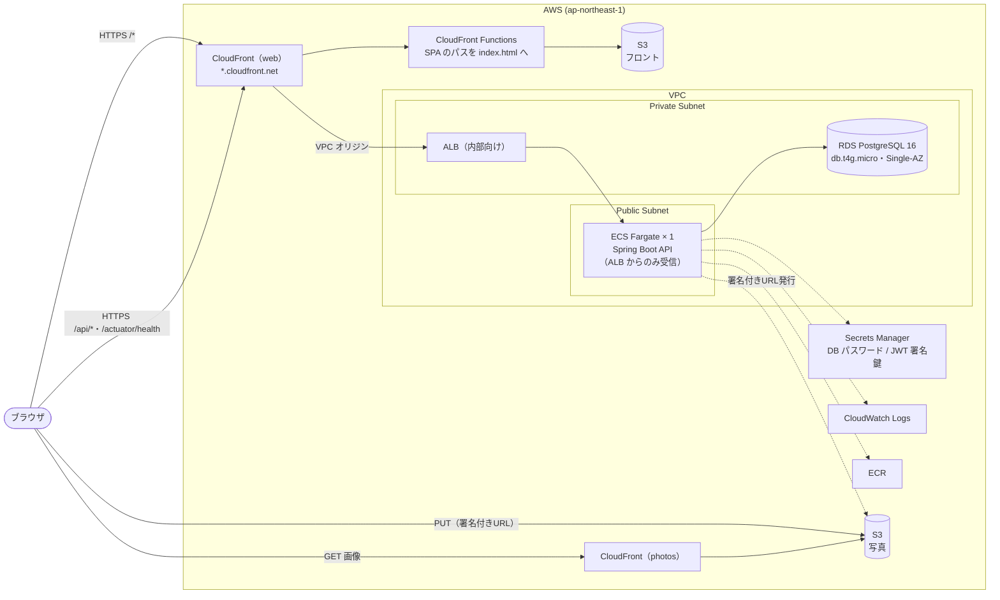

# AWS デモ環境 デプロイ手順書

| 項目 | 内容 |
| --- | --- |
| 対象 | TripDiary のデモ環境（メンターレビュー用。数日だけ動かして削除する） |
| 作成日 | 2026-11-11 |
| 関連資料 | [architecture.md](./architecture.md) / [rules.md](./rules.md) |
| コード | [infra/terraform/](../infra/terraform/)（Terraform）、[infra/deploy.ps1](../infra/deploy.ps1)（デプロイスクリプト）、[backend/Dockerfile](../backend/Dockerfile) |

---

## 1. 構成

[architecture.md](./architecture.md) 2章の本番構成をもとに、**費用を抑えるために台数と冗長化を減らした構成**です。



### 1.1 本番構成（設計書）との違い

| 項目 | 設計書（本番） | デモ環境 | 理由 |
| --- | --- | --- | --- |
| API のタスク数 | 2台以上 | 1台 | 費用 |
| RDS | Multi-AZ・バックアップ7日 | Single-AZ・バックアップ1日 | 費用 |
| API の置き場所 | プライベートサブネット＋NAT Gateway | パブリックサブネット（パブリック IP あり） | NAT Gateway（約 $45/月）を使わないため。受信はセキュリティグループで ALB からのみに制限 |
| ALB | インターネット向け・HTTPS（ACM） | 内部向け・HTTP。CloudFront の VPC オリジン経由でのみ届く | 独自ドメインがなく ACM の証明書を作れないため。ALB をインターネットに公開しない |
| ドメイン | 独自ドメイン | CloudFront の既定のドメイン（`*.cloudfront.net`） | 費用・期間 |
| ログの保持 | 30日 | 7日 | デモ環境のため |
| 監視（アラーム・SNS） | あり | なし | 数日で削除するため |

### 1.2 設計上のポイント

- **画面と API を同じ CloudFront で配信する。** リフレッシュトークンの Cookie が `SameSite=Strict` のため、画面と API のドメインが違うと Cookie が送られず、再読み込みでログインが切れる。`/api/*` と `/actuator/health` だけを ALB に転送する。
- **SPA のルーティングは CloudFront Functions で行う。** 403/404 のカスタムエラーレスポンスで `index.html` を返す一般的な方法は、API の 404（JSON）まで `index.html` に書き換えてしまうため使わない。
- **API はキャッシュしない。** `Authorization` ヘッダーはキャッシュポリシーに含めないとオリジンへ転送されないため、キャッシュキーに含めた上で TTL を 0 にしている。
- **秘密情報はコードに出さない。** DB のパスワードは RDS が Secrets Manager で管理し、JWT の署名鍵は Terraform が生成して Secrets Manager に保存する。どちらも ECS が起動時に環境変数として渡す。
- **写真バケット**は CORS で画面のドメインからの `PUT` だけを許可し、読み取りは CloudFront（OAC）経由のみ。

### 1.3 費用の目安（東京リージョン、概算）

| リソース | 1日あたり |
| --- | --- |
| ALB | 約 $0.6 |
| ECS Fargate（0.5 vCPU・1GB × 1） | 約 $0.75 |
| RDS（db.t4g.micro・20GB） | 約 $0.7 |
| パブリック IPv4、Secrets Manager、CloudWatch Logs、S3、CloudFront など | 約 $0.3 |
| **合計** | **約 $2.3/日（3日で約 $7）** |

AWS の無料プラン（Free plan）のクレジットから差し引かれる。

---

## 2. 前提

| ツール | 確認したバージョン |
| --- | --- |
| AWS CLI（認証済み。`aws sts get-caller-identity` が通ること） | 2.36 |
| Terraform | 1.15 |
| Docker Desktop | 29.2 |
| Node.js | 24 |

Terraform の状態ファイル（`infra/terraform/terraform.tfstate`）は**手元にだけ置く**（JWT の署名鍵を含むためコミットしない。`.gitignore` 済み）。削除するまで消さないこと。

---

## 3. 作成・更新

リポジトリのルートで実行する。

```powershell
powershell -ExecutionPolicy Bypass -File infra/deploy.ps1
```

| オプション | 内容 |
| --- | --- |
| `-SkipBackend` | API のイメージを作り直さない（フロントエンドだけ更新） |
| `-SkipFrontend` | フロントエンドを配置しない（API だけ更新） |
| `-AutoApprove` | `terraform apply` の確認を省略する |

スクリプトの処理:

1. ECR リポジトリを作成（`terraform apply -target`）
2. API のイメージをビルドして ECR に push（タグは `コミットID-日時`）
3. `terraform apply` で残りのリソースを作成し、新しいイメージで ECS を更新
4. フロントエンドをビルドして S3 に配置し、CloudFront のキャッシュを削除
5. ECS のサービスが安定するまで待ち、URL を表示

初回は RDS と CloudFront の作成に 15〜20 分ほどかかる。

### 3.1 動作確認

```powershell
# アプリの URL
terraform -chdir=infra/terraform output -raw web_url

# API のログ（JSON）
aws logs tail /ecs/tripdiary-api --follow

# E2E テストをデモ環境に対して実行する（テスト用のユーザー・投稿が作られる）
cd frontend
$env:E2E_BASE_URL = (terraform -chdir=../infra/terraform output -raw web_url)
npx playwright test
Remove-Item Env:E2E_BASE_URL
```

---

## 4. 削除

```powershell
terraform -chdir=infra/terraform destroy
```

- DB・写真・ログなど、**すべてのデータが消える**（最終スナップショットは取らない）。
- CloudFront の無効化・削除に時間がかかるため、完了まで 10〜20 分ほどかかる。
- 削除後、AWS コンソールの「請求とコスト管理」で、課金が止まっていることを確認する。

---

## 5. 既知の制約

| 項目 | 内容 |
| --- | --- |
| HTTPS の区間 | ブラウザ〜CloudFront は HTTPS。CloudFront〜ALB は HTTP だが、VPC オリジンのため AWS のネットワーク内で完結し、インターネットを通らない |
| ログイン試行の制限 | API が1台のため、制限（同一 IP から5分間に10回）は設計どおり全体に効く |
| 可用性 | API・DB とも1台のため、障害やデプロイ時に一時的に止まることがある |
| スロースタート | ターゲットグループに設定済み（60秒）。ただし、ほかに正常なタスクがいないときは効かないため、1台構成では意味を持たない |
