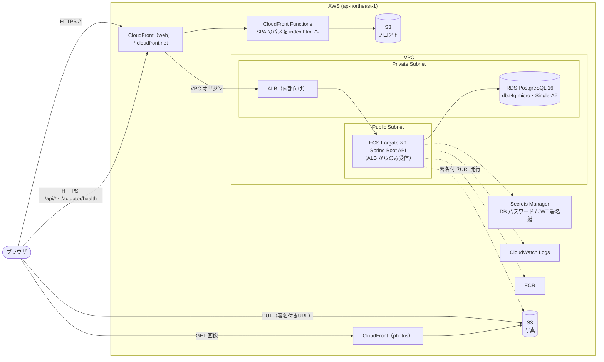
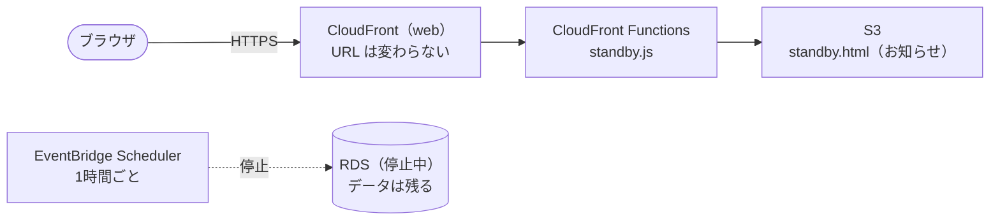

# AWS デモ環境 デプロイ手順書

| 項目 | 内容 |
| --- | --- |
| 対象 | TripDiary のデモ環境（メンターレビュー・選考用。見てもらうときだけ起動し、それ以外は待機モードにする） |
| 作成日 | 2026-11-11（更新: 2026-11-22 待機モードを追加） |
| 関連資料 | [architecture.md](./architecture.md) / [rules.md](./rules.md) |
| コード | [infra/terraform/](../infra/terraform/)（Terraform）、[infra/deploy.ps1](../infra/deploy.ps1)（作成・更新・起動）、[infra/standby.ps1](../infra/standby.ps1)（待機）、[backend/Dockerfile](../backend/Dockerfile) |

---

## 1. 構成

[architecture.md](./architecture.md) 2章の本番構成をもとに、**費用を抑えるために台数と冗長化を減らした構成**です。



### 1.1 本番構成（設計書）との違い

| 項目 | 設計書（本番） | デモ環境 | 理由 |
| --- | --- | --- | --- |
| API のタスク数 | 2台以上 | 1台 | 費用 |
| RDS | Multi-AZ・バックアップ7日 | Single-AZ・バックアップ1日 | 費用 |
| API の置き場所 | プライベートサブネット＋NAT Gateway | パブリックサブネット（パブリック IP あり） | NAT Gateway（約 $45/月）を使わないため。受信はセキュリティグループで ALB からのみに制限 |
| ALB | インターネット向け・HTTPS（ACM） | 内部向け・HTTP。CloudFront の VPC オリジン経由でのみ届く | 独自ドメインがなく ACM の証明書を作れないため。ALB をインターネットに公開しない |
| ドメイン | 独自ドメイン | CloudFront の既定のドメイン（`*.cloudfront.net`） | 費用・期間 |
| ログの保持 | 30日 | 7日 | デモ環境のため |
| 監視（アラーム・SNS） | あり | なし | 数日で削除するため |

### 1.2 設計上のポイント

- **画面と API を同じ CloudFront で配信する。** リフレッシュトークンの Cookie が `SameSite=Strict` のため、画面と API のドメインが違うと Cookie が送られず、再読み込みでログインが切れる。`/api/*` と `/actuator/health` だけを ALB に転送する。
- **SPA のルーティングは CloudFront Functions で行う。** 403/404 のカスタムエラーレスポンスで `index.html` を返す一般的な方法は、API の 404（JSON）まで `index.html` に書き換えてしまうため使わない。
- **ALB は CloudFront からの通信だけを受け付ける。** VPC オリジンを作ると、CloudFront が VPC 内にネットワークインターフェースとセキュリティグループ（`CloudFront-VPCOrigins-Service-SG`）を作る。ALB のセキュリティグループでは、**このセキュリティグループを参照して**受信を許可する（VPC の CIDR で許可しても通らず、504 になる）。
- **API はキャッシュしない。** `Authorization` ヘッダーはキャッシュポリシーに含めないとオリジンへ転送されないため、キャッシュキーに含めた上で TTL を 0 にしている。
- **秘密情報はコードに出さない。** DB のパスワードは RDS が Secrets Manager で管理し、JWT の署名鍵は Terraform が生成して Secrets Manager に保存する。どちらも ECS が起動時に環境変数として渡す。
- **写真バケット**は CORS で画面のドメインからの `PUT` だけを許可し、読み取りは CloudFront（OAC）経由のみ。

### 1.3 費用の目安（東京リージョン、概算）

| リソース | 1日あたり |
| --- | --- |
| ALB | 約 $0.6 |
| ECS Fargate（0.5 vCPU・1GB × 1） | 約 $0.75 |
| RDS（db.t4g.micro・20GB） | 約 $0.7 |
| パブリック IPv4、Secrets Manager、CloudWatch Logs、S3、CloudFront など | 約 $0.3 |
| **合計** | **約 $2.3/日（3日で約 $7）** |

AWS の無料プラン（Free plan）のクレジットから差し引かれる。2026-11-21〜22 に約1日動かした実績は約 $1.6 だった。

使わない間は [待機モード](#4-待機モード) にすると、URL を変えずに約 $0.1/日（主に RDS のストレージ代）まで下げられる。クレジットの残りと期限は次で確認できる。

```powershell
aws freetier get-account-plan-state
```

---

## 2. 前提

| ツール | 確認したバージョン |
| --- | --- |
| AWS CLI（認証済み。`aws sts get-caller-identity` が通ること） | 2.36 |
| Terraform | 1.15 |
| Docker Desktop | 29.2 |
| Node.js | 24 |

Terraform の状態ファイル（`infra/terraform/terraform.tfstate`）は**手元にだけ置く**（JWT の署名鍵を含むためコミットしない。`.gitignore` 済み）。削除するまで消さないこと。

---

## 3. 作成・更新

リポジトリのルートで実行する。

```powershell
powershell -ExecutionPolicy Bypass -File infra/deploy.ps1
```

| オプション | 内容 |
| --- | --- |
| `-SkipBackend` | API のイメージを作り直さない（フロントエンドだけ更新） |
| `-SkipFrontend` | フロントエンドを配置しない（API だけ更新） |
| `-AutoApprove` | `terraform apply` の確認を省略する |

スクリプトの処理:

1. ECR リポジトリを作成（`terraform apply -target`）
2. API のイメージをビルドして ECR に push（タグは `コミットID-日時`）
3. `terraform apply` で残りのリソースを作成し、新しいイメージで ECS を更新
4. フロントエンドをビルドして S3 に配置し、CloudFront のキャッシュを削除
5. ECS のサービスが安定するまで待ち、URL を表示

初回は RDS と CloudFront の作成に 15〜20 分ほどかかる。

### 3.1 実施記録

| 日付 | 内容 | 結果 |
| --- | --- | --- |
| 2026-11-11 | 初回構築（54リソース） | `/api/*` が 504 → ALB のセキュリティグループを修正（1.2）して解消。E2E 17件をデモ環境に対して実行し、すべて成功。ERROR・WARN ログ 0件 |
| 2026-11-11 | E2E のテストデータを削除（3.4）し、サンプルデータを投入（3.3） | トップ・ログイン・投稿詳細の表示を確認 |

### 3.2 動作確認

```powershell
# アプリの URL
terraform -chdir=infra/terraform output -raw web_url

# API のログ（JSON）
aws logs tail /ecs/tripdiary-api --follow

# E2E テストをデモ環境に対して実行する（テスト用のユーザー・投稿が作られる）
cd frontend
$env:E2E_BASE_URL = (terraform -chdir=../infra/terraform output -raw web_url)
npx playwright test
Remove-Item Env:E2E_BASE_URL
```

### 3.3 サンプルデータ

メンターさんが見て操作できるよう、API を通してサンプルデータ（ユーザー3人〈アイコン付き〉・投稿14件〈うち非公開1件、お寺の参拝記録4件（瑞龍寺・龍安寺・長谷寺・清水寺。5段階評価・特徴タグ付き。瑞龍寺は写真なし）〉・写真19枚・コメント・行ってみたい！・参考になった・フォロー・行った！/行きたい・お寺コミュニティ広場のトピック3件と返信・テーマ別コミュニティ4つ〈北陸・富山のお寺巡り同好会／限定御朱印情報シェアの会／枯山水・日本庭園を愛でる会／はじめてのお寺巡り相談室。メンバー・トピック・返信付き〉）を入れる。3人とも書き込みが5件以上あるため、称号は「お寺マイスター」になる。ゲスト（ハルカ）は「限定御朱印情報シェアの会」のオーナーで、「はじめてのお寺巡り相談室」には参加していない（参加ボタンを試せる）。ローカル環境（`http://localhost:8080`）にも同じ手順で入れられる。

```powershell
$env:DEMO_PASSWORD = '<3ユーザー共通のパスワード>'   # コミットしない
$env:OWNER_PASSWORD = '<作者用アカウントのパスワード>' # 任意。コミットしない
node infra/demo-seed.mjs (terraform -chdir=infra/terraform output -raw web_url)
Remove-Item Env:DEMO_PASSWORD, Env:OWNER_PASSWORD
```

**ゲストログイン**（[01_auth.md 4.8](./features/01_auth.md#48-ゲストログイン-get-authguest)）を使う場合は、デプロイ前に `DEMO_PASSWORD` と同じ値を Terraform の変数 `guest_password` に渡す（ゲストはハルカ。`guest_email` で変更可）。設定しなければゲストログインは表示されない。パスワードはログイン画面に表示されるため、ほかで使っていない値にすること。

待機と起動を繰り返すたびに渡し忘れないよう、手元のファイル `infra/terraform/guest.auto.tfvars` に書いておくのがおすすめ（Terraform が自動で読み込む。`*.auto.tfvars` は `.gitignore` 済みでコミットされない）。どちらもないと、スクリプトが注意を表示する。

```powershell
# おすすめ: ファイルに書いておく（コミットされない）
Set-Content infra/terraform/guest.auto.tfvars 'guest_password = "<DEMO_PASSWORD と同じ値>"' -Encoding ascii

# または、その都度環境変数で渡す
$env:TF_VAR_guest_password = '<DEMO_PASSWORD と同じ値>'
powershell -ExecutionPolicy Bypass -File infra/deploy.ps1
```

`OWNER_PASSWORD` を設定すると、作者が操作する用のアカウント `kuro@example.com`（クロ。黒猫のアイコン・投稿なし・3人をフォロー済み）も作る。面接などで投稿の作成を実演するときに使う。

| メールアドレス | 表示名 |
| --- | --- |
| `haruka@example.com` | 旅するハルカ（非公開の投稿あり。ログインして見てもらう用） |
| `kenta@example.com` | カメラ好きのケンタ |
| `misaki@example.com` | 温泉めぐりのミサキ |

写真は [Wikimedia Commons](https://commons.wikimedia.org/) から、**CC0 またはパブリックドメイン**（クレジット表記が不要で、改変・再配布も自由）のものだけを選んでいる。リポジトリには画像を置かず、スクリプトの実行時に縮小版（投稿の写真は幅1920px程度で1枚 0.5〜1MB、アイコンは幅800px程度）をダウンロードし、画面と同じ処理（`stripMetadata.ts`）でメタデータを取り除いてから、署名付きURLで S3 にアップロードする。インターネットへの接続が必要。

| 投稿・アイコン | ファイル（Wikimedia Commons） | 作者 | ライセンス |
| --- | --- | --- | --- |
| アイコン（ハルカ） | [Sakura-mochi 003.jpg](https://commons.wikimedia.org/wiki/File:Sakura-mochi_003.jpg) | Ocdp | CC0 |
| アイコン（ケンタ） | [Canon AE-1 Program (Unsplash).jpg](https://commons.wikimedia.org/wiki/File:Canon_AE-1_Program_(Unsplash).jpg) | Mark Solarski | CC0 |
| アイコン（クロ・作者用） | [Black stray cat of Braies Lake, Trentino-Alto Adige, Italy.jpg](https://commons.wikimedia.org/wiki/File:Black_stray_cat_of_Braies_Lake,_Trentino-Alto_Adige,_Italy.jpg) | LeosCommons | CC0 |
| アイコン（ミサキ） | [251130 Yubatake, Kusatsu 01.jpg](https://commons.wikimedia.org/wiki/File:251130_Yubatake,_Kusatsu_01.jpg) | Aspere | CC0 |
| 白川郷 | [Shirakawa-go - Shirakawa178.jpg](https://commons.wikimedia.org/wiki/File:Shirakawa-go_-_Shirakawa178.jpg) | lumoplank | CC0 |
| 倉敷美観地区 | [倉敷美観地区3.jpg](https://commons.wikimedia.org/wiki/File:倉敷美観地区3.jpg) | キアラア | CC0 |
| 上高地 | [Kamikochi - Kamikochi6519.jpg](https://commons.wikimedia.org/wiki/File:Kamikochi_-_Kamikochi6519.jpg)、[Kamikochi6522.jpg](https://commons.wikimedia.org/wiki/File:Kamikochi_-_Kamikochi6522.jpg) | lumoplank | CC0 |
| 別府 | [Akaike (Red Pond Hotspring) Beppu Japan.jpg](https://commons.wikimedia.org/wiki/File:Akaike_(Red_Pond_Hotspring)_Beppu_Japan.jpg) | Photos of Japan | CC0 |
| 九份 | [A-mei Tea House.jpg](https://commons.wikimedia.org/wiki/File:A-mei_Tea_House.jpg) | lumoplank | CC0 |
| 九份 | [Night in Jioufen view from Mt. Keelung 20130711.jpg](https://commons.wikimedia.org/wiki/File:Night_in_Jioufen_view_from_Mt._Keelung_20130711.jpg) | Taiwankengo | パブリックドメイン |
| 黒川温泉 | [Kurokawa-Onsen Light-up.jpg](https://commons.wikimedia.org/wiki/File:Kurokawa-Onsen_Light-up.jpg) | MaedaAkihiko | CC0 |
| 厳島神社 | [20181111 Itsukushima Shrine torii-2.jpg](https://commons.wikimedia.org/wiki/File:20181111_Itsukushima_Shrine_torii-2.jpg) | Balon Greyjoy | CC0 |
| 伏見稲荷大社 | [Fushimi Inari Torii 4](https://commons.wikimedia.org/wiki/File:20181110_Fushimi_Inari_Torii_4.jpg)・[1](https://commons.wikimedia.org/wiki/File:20181110_Fushimi_Inari_Torii_1.jpg)・[5](https://commons.wikimedia.org/wiki/File:20181110_Fushimi_Inari_Torii_5.jpg) | Balon Greyjoy | CC0 |
| 古宇利島 | [Kouri-Beach.jpg](https://commons.wikimedia.org/wiki/File:Kouri-Beach.jpg) | MaedaAkihiko | CC0 |
| 古宇利島 | [Kouri Island.JPG](https://commons.wikimedia.org/wiki/File:Kouri_Island.JPG) | Kugel | パブリックドメイン |
| 龍安寺 | [Masayoshi Yanase 2015 (Unsplash).jpg](https://commons.wikimedia.org/wiki/File:Masayoshi_Yanase_2015_(Unsplash).jpg) | Masayoshi Yanase | CC0 |
| 長谷寺 | [Hase-dera Temple, Kamakura, Japan (14645090803).jpg](https://commons.wikimedia.org/wiki/File:Hase-dera_Temple,_Kamakura,_Japan_(14645090803).jpg) | Mustang Joe | CC0 |
| 長谷寺 | [Rock garden façade of the Inner Buddha Hall, Hase-dera, Kamakura, 2016.jpg](https://commons.wikimedia.org/wiki/File:Rock_garden_façade_of_the_Inner_Buddha_Hall,_Hase-dera,_Kamakura,_2016.jpg) | DimiTalen | CC0 |
| 清水寺 | [Kiyomizu-dera autumn night.jpg](https://commons.wikimedia.org/wiki/File:Kiyomizu-dera_autumn_night.jpg)、[Kiyomizu-dera311.jpg](https://commons.wikimedia.org/wiki/File:Kiyomizu-dera_-_Kiyomizu-dera311.jpg) | lumoplank | CC0 |

瑞龍寺（高岡）は、Commons にお寺を写した CC0・パブリックドメインの写真がないため写真を付けていない。

ローカル環境で E2E を実行すると `e2e_` のテストデータが混ざるため、人に見せる前は次のように入れ直す（開発用 DB のユーザー・投稿はすべて消える）。

```powershell
docker exec tripdiary-db psql -U tripdiary -d tripdiary -c "TRUNCATE users RESTART IDENTITY CASCADE;"
$env:DEMO_PASSWORD = 'Demo1234'   # local プロファイルのゲストログインの設定（application-local.yml）に合わせる
$env:OWNER_PASSWORD = '<作者用アカウントのパスワード>'
node infra/demo-seed.mjs http://localhost:8080
Remove-Item Env:DEMO_PASSWORD, Env:OWNER_PASSWORD
```

S3Mock に残った古い写真は、孤立ファイル削除（毎時）で片付く。

### 3.4 データを空にする

RDS はプライベートサブネットにあり手元から接続できないため、一時的な ECS タスク（`public.ecr.aws/docker/library/postgres:16-alpine`）を API と同じサブネット・セキュリティグループで1回だけ動かし、次の SQL を実行する。エリアタグ（マスターデータ）は残る。終わったらタスク定義を登録解除する。

```sql
TRUNCATE users RESTART IDENTITY CASCADE;
```

あわせて写真バケットも空にする（`aws s3 rm s3://tripdiary-photos-<アカウントID> --recursive`）。

---

## 4. 待機モード

見てもらう予定がない間は、**URL とデータを残したまま、費用のかかるものだけを止める**。毎回 `terraform destroy` で消すと、作り直すたびに CloudFront の URL（`*.cloudfront.net`）が変わってしまうため。

### 4.1 待機中に残すもの・止めるもの

| リソース | 待機中 | 理由 |
| --- | --- | --- |
| CloudFront（web・photos）・S3 | 残す | URL を変えないため。費用はほぼかからない |
| RDS | **停止**（データは残る） | かかるのはストレージ代（20GB）だけになる |
| ALB・VPC オリジン | **削除** | ALB は止めておけず、置いておくだけで約 $0.6/日かかるため |
| ECS サービス | **削除** | タスク定義と ECR のイメージは残し、起動時に同じイメージで作り直す |
| RDS を止める予約（EventBridge Scheduler） | **待機中だけ作る** | RDS は停止しても7日で自動的に起動するため、1時間ごとに停止を試みる |
| VPC・Secrets Manager・CloudWatch Logs・ECR | 残す | 費用はほぼかからない |

待機中は、どのページを開いても **お知らせページ**（[pages/standby.html](../infra/terraform/pages/standby.html)）を表示する。「デモ環境は停止中であること」と GitHub・設計資料へのリンクを載せ、採用担当者の方などが開いても壊れた画面に見えないようにしている。切り替えは CloudFront Functions（[functions/standby.js](../infra/terraform/functions/standby.js)）で行い、`/api/*` には 503 を返す。



### 4.2 待機モードにする

```powershell
powershell -ExecutionPolicy Bypass -File infra/standby.ps1
```

1. Terraform を `standby=true` で apply する（ALB・VPC オリジン・ECS サービスを削除し、お知らせページに切り替え、RDS を止める予約を作る）
2. RDS を停止し、停止するまで待つ
3. CloudFront のキャッシュを消す

CloudFront の更新と VPC オリジンの削除があるため、10〜20 分ほどかかる。

### 4.3 起動する

```powershell
powershell -ExecutionPolicy Bypass -File infra/deploy.ps1 -SkipBackend -SkipFrontend
```

1. RDS を止める予約を外し、RDS を起動して、使えるようになるまで待つ
2. Terraform を `standby=false` で apply する（ALB・VPC オリジン・ECS サービスを作り、画面を元に戻す）
3. CloudFront のキャッシュを消し、API が起動するまで待つ

`-SkipBackend -SkipFrontend` で、待機前と同じイメージ・画面のまま起動する。コードを更新したときは外す。ALB と VPC オリジンの作成に時間がかかるため、**見てもらう前日か、遅くとも数時間前に起動する**。起動後は 3.2 の手順で、ゲストログインと投稿の表示を確認する。

### 4.4 注意

- **Terraform を直接 apply しない。** `standby` の値を渡し忘れると既定値（`false`＝起動）になる。切り替えは必ずスクリプトで行う。
- **使い終わったら待機に戻す。** 起動したままにすると、1日 $1.6〜2.3 かかり続ける。
- 待機中に AWS コンソールで RDS を起動しても、1時間以内に予約で停止される。
- 待機モードでも Free plan の期限（`aws freetier get-account-plan-state` の `accountPlanExpirationDate`）が来ると、アカウントごと使えなくなる。

---

## 5. 削除

すべてのリソースを消す（URL も変わる）。待機モード中でもそのまま実行できる。

```powershell
terraform -chdir=infra/terraform destroy
```

- DB・写真・ログなど、**すべてのデータが消える**（最終スナップショットは取らない）。
- CloudFront の無効化・削除に時間がかかるため、完了まで 10〜20 分ほどかかる。
- `CloudFront-VPCOrigins-Service-SG` は CloudFront が作ったもので、Terraform の管理外。VPC の削除がこのセキュリティグループのせいで失敗した場合は、数分待って VPC オリジンの削除が反映されてから、もう一度 `terraform destroy` を実行する（残る場合は EC2 コンソールから手動で削除する）。
- 削除後、AWS コンソールの「請求とコスト管理」で、課金が止まっていることを確認する。

---

## 6. 既知の制約

| 項目 | 内容 |
| --- | --- |
| HTTPS の区間 | ブラウザ〜CloudFront は HTTPS。CloudFront〜ALB は HTTP だが、VPC オリジンのため AWS のネットワーク内で完結し、インターネットを通らない |
| テストデータ | E2E をデモ環境に対して実行すると、`e2e_` で始まるユーザーと投稿が残る（3.4 の手順で消せる） |
| 起動時間 | 0.5 vCPU のため、API の起動に約60秒かかる（ヘルスチェックの猶予は180秒） |
| 可用性 | API・DB とも1台のため、障害やデプロイ時に一時的に止まることがある |
| スロースタート | ターゲットグループに設定済み（60秒）。ただし、ほかに正常なタスクがいないときは効かないため、1台構成では意味を持たない |
