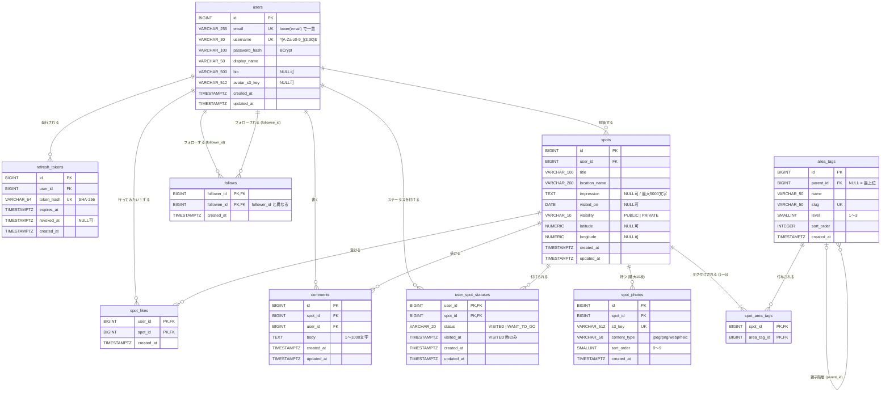
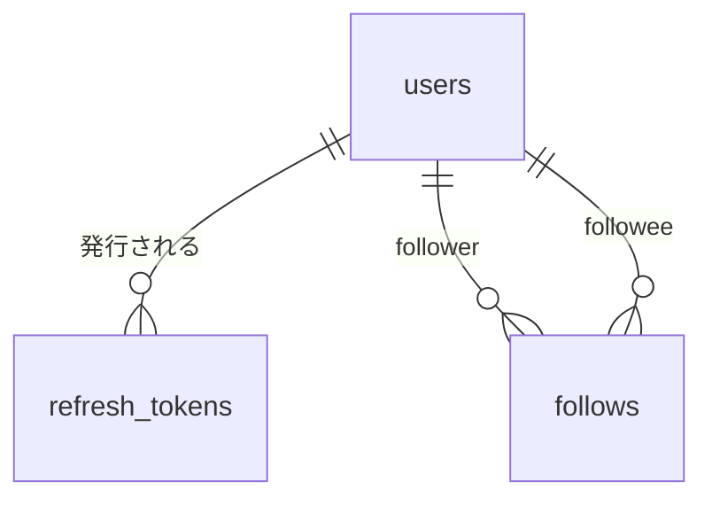
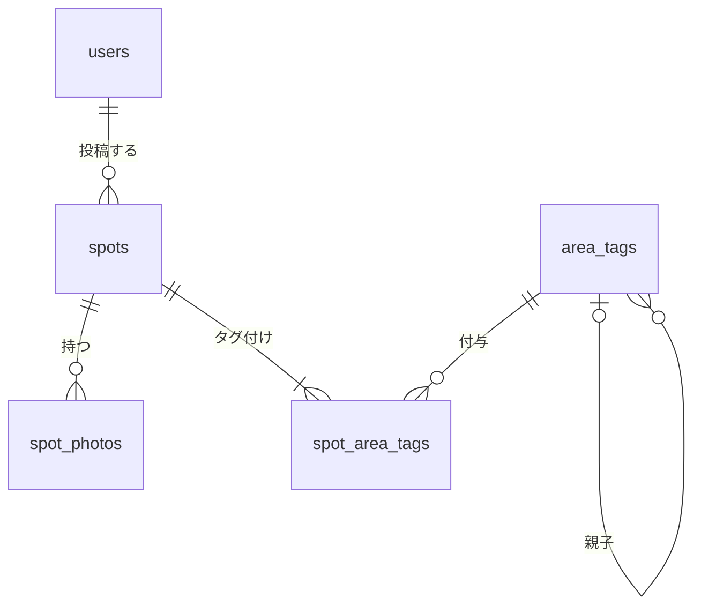
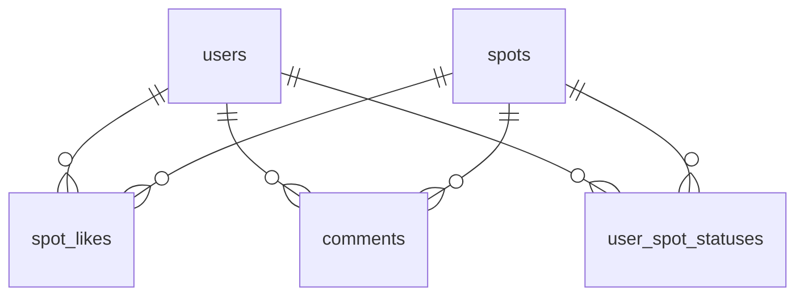

# TripDiary ER図

| 項目 | 内容 |
| --- | --- |
| ドキュメント | ER図（Mermaid 記法） |
| バージョン | 0.1（初版ドラフト） |
| 作成日 | 2026-11-11 |
| 関連資料 | [database_schema.md](./database_schema.md)（型・制約・インデックス・DDL の詳細） |

> 本図はテーブル構造の全体像を示す。各カラムの詳細な型・CHECK 制約・インデックスは [database_schema.md](./database_schema.md) を正とする。スキーマを変更する場合は両ファイルを同時に更新すること。

---

## 1. ER図（全カラム）

> Mermaid の erDiagram は型名に `(` `)` を使えないため、`VARCHAR(255)` を `VARCHAR_255` と表記している。

---

## 2. 機能別ビュー

### 2.1 認証・ユーザー

### 2.2 スポット投稿・検索

### 2.3 リアクション・個人リスト

---

## 3. カーディナリティ早見表

| 関係 | 種別 | 実現方法 |
| --- | --- | --- |
| ユーザー → スポット | 1 : N | `spots.user_id` |
| スポット → 写真 | 1 : 0..10 | `spot_photos.spot_id` |
| スポット ⇔ エリアタグ | N : M（1スポットに1〜5タグ） | `spot_area_tags` |
| エリアタグ → エリアタグ | 1 : N（自己参照） | `area_tags.parent_id` |
| ユーザー ⇔ スポット（行ってみたい！） | N : M | `spot_likes` |
| ユーザー ⇔ スポット（訪問済み/行きたい） | N : M（1組につき1ステータス） | `user_spot_statuses` |
| ユーザー → コメント ← スポット | 1 : N / 1 : N | `comments.user_id`, `comments.spot_id` |
| ユーザー ⇔ ユーザー（フォロー） | N : M（自己参照） | `follows` |
