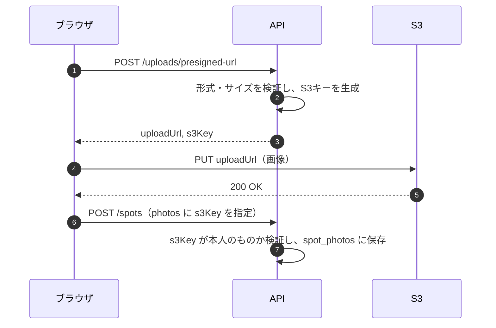

# 03. 写真アップロード（PHOTO）

| 項目 | 内容 |
| --- | --- |
| 機能ID | PHOTO-01 〜 PHOTO-07 |
| 関連テーブル | `spot_photos`, `users.avatar_s3_key` |
| 関連資料 | [要件定義書 3.3](../requirements.md#33-写真アップロードphoto) / [アーキテクチャ 4.2](../architecture.md#42-写真アップロードフロー) |

---

## 1. 概要

スポットの写真とユーザーのアイコン画像を Amazon S3 に保存します。
画像は API サーバーを経由せず、**API が発行した署名付きURL（Presigned URL）を使ってブラウザから S3 へ直接アップロード** します。API サーバーの負荷と通信量を抑えるためです。

## 2. ユーザーストーリー

- ユーザーとして、スマートフォンで撮った写真をそのまま投稿に添付したい。
- ユーザーとして、複数の写真を並び替えて、最初の1枚をカバー写真にしたい。
- ユーザーとして、アップロードの進み具合を見たい。

## 3. 処理の流れ



## 4. 画面・UI

- 投稿作成・編集画面で、ファイル選択またはドラッグ&ドロップで写真を追加します。
- 選択した時点でアップロードを開始し、サムネイルと進捗バーを表示します。
- サムネイルはドラッグで並び替えでき、先頭がカバー写真になります。
- 失敗した写真は再試行ボタンを表示します。
- 形式・サイズが条件外の場合は、アップロード前にクライアント側でエラーを表示します。

## 5. API 仕様

### 5.1 署名付きURL発行 `POST /uploads/presigned-url`（認証必要）

リクエスト:

```json
{ "purpose": "SPOT_PHOTO", "contentType": "image/jpeg", "contentLength": 2457600 }
```

| 項目 | 説明 |
| --- | --- |
| `purpose` | `SPOT_PHOTO`（スポット写真）/ `AVATAR`（アイコン） |
| `contentType` | 画像の MIME タイプ |
| `contentLength` | ファイルサイズ（バイト） |

レスポンス `200 OK`:

```json
{
  "uploadUrl": "https://tripdiary-photos.s3.ap-northeast-1.amazonaws.com/spots/42/9c1e...jpg?X-Amz-Signature=...",
  "s3Key": "spots/42/9c1e4b7a-....jpg",
  "expiresAt": "2026-11-11T03:20:42Z"
}
```

### 5.2 S3 へのアップロード（ブラウザ → S3）

`PUT {uploadUrl}`、ヘッダ `Content-Type` は 5.1 で指定した値と同じにします。

### 5.3 投稿への紐付け

[02_spot.md](02_spot.md) の作成・更新 API の `photos` 配列に `s3Key` と `sortOrder` を指定します。

## 6. 業務ルール・バリデーション

| 項目 | ルール |
| --- | --- |
| 対応形式 | `image/jpeg`, `image/png`, `image/webp`, `image/heic` |
| サイズ上限 | 1枚あたり 10MB（アイコンは 5MB） |
| 枚数上限 | 1投稿あたり10枚 |
| S3 キー | `spots/{userId}/{UUID}.{拡張子}`、`avatars/{userId}/{UUID}.{拡張子}`。ファイル名はユーザー入力を使わない |
| 有効期限 | 署名付きURLは発行から5分 |
| 署名条件 | Content-Type とサイズ上限を署名の条件に含め、条件外のアップロードを S3 側で拒否する |
| 紐付け時の検証 | `s3Key` が `spots/{自分のuserId}/` で始まること、S3 上に実在すること（HeadObject）、他の投稿で使用されていないこと |
| 配信 | DB には `s3Key` のみ保存し、URL はアプリ側で配信ドメイン（CloudFront）と組み合わせて生成 |
| バケット | パブリックアクセスブロック有効。読み取りは CloudFront（OAC）経由のみ |
| 不要ファイルの削除 | 投稿の削除・写真の差し替え時は S3 から削除。投稿に紐付かないまま24時間経過したファイルはバッチで削除 |

## 7. 関連テーブル

| テーブル | 用途 |
| --- | --- |
| `spot_photos` | 投稿と写真（`s3_key`・`content_type`・`sort_order`）の紐付け |
| `users` | `avatar_s3_key` にアイコンのキーを保存 |

## 8. エラーコード

| HTTP | コード | 発生条件 |
| --- | --- | --- |
| 400 | `UNSUPPORTED_CONTENT_TYPE` | 対応していない画像形式 |
| 400 | `FILE_TOO_LARGE` | サイズ上限超過 |
| 400 | `TOO_MANY_PHOTOS` | 1投稿11枚以上 |
| 400 | `INVALID_PHOTO_KEY` | 他人のキー、存在しないキー、使用済みのキー |
| 500 | `STORAGE_ERROR` | S3 への接続・署名生成の失敗（ERROR ログ出力） |

## 9. テスト観点

- 許可外の Content-Type・サイズ超過で 400 になること
- 他ユーザーのプレフィックスのキーを指定すると拒否されること
- 投稿削除時に S3 の削除処理が呼ばれること
- 結合テストでは LocalStack を使い、実際の AWS には接続しないこと
- 署名付きURLがログに出力されないこと

## 10. 補足・将来検討

- 一覧用サムネイルの自動生成（Lambda など）は将来対応（PHOTO-07）。
- 写真の EXIF に含まれる位置情報の削除は、プライバシー保護のため早めの対応を推奨します。
- HEIC はブラウザによって表示できないため、表示用に JPEG 変換するかを実装時に検討します。
