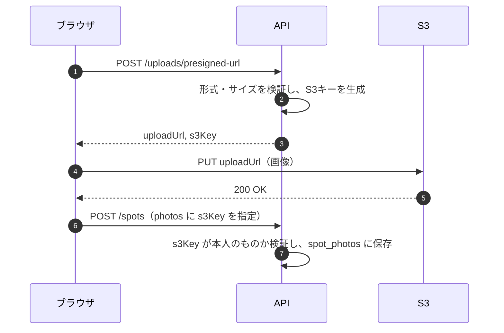

# 03. 写真アップロード（PHOTO）

| 項目 | 内容 |
| --- | --- |
| 機能ID | PHOTO-01 〜 PHOTO-07 |
| 関連テーブル | `spot_photos`, `users.avatar_s3_key` |
| 関連資料 | [要件定義書 3.3](../requirements.md#33-写真アップロードphoto) / [アーキテクチャ 4.2](../architecture.md#42-写真アップロードフロー) |

---

## 1. 概要

スポットの写真とユーザーのアイコン画像を Amazon S3 に保存します。
画像は API サーバーを経由せず、**API が発行した署名付きURL（Presigned URL）を使ってブラウザから S3 へ直接アップロード** します。API サーバーの負荷と通信量を抑えるためです。

### 実装状況

| 項目 | 状況 |
| --- | --- |
| 署名付きURL発行・直接アップロード・投稿への紐付け・制限・表示（PHOTO-01〜05） | 実装済み |
| 投稿削除・写真の差し替え時の S3 ファイル削除 | 実装済み（コミット後に非同期で削除） |
| 孤立ファイル削除（PHOTO-06） | 実装済み（毎時のバッチ） |
| HEIC の JPEG 変換 | 実装済み（ブラウザで変換。10章） |
| 位置情報などのメタデータ（EXIF・XMP・IPTC など）の除去 | 実装済み（ブラウザで除去。6章） |
| アイコン（`purpose: AVATAR`） | 実装済み（保存はプロフィール更新 `PATCH /users/me`。[01_auth.md 4.6](01_auth.md#46-プロフィール更新-patch-usersme)） |
| サムネイル生成（PHOTO-07） | 将来対応 |

### ローカル環境・テストの S3

S3 のローカル代替には **[Adobe S3Mock](https://github.com/adobe/S3Mock)**（Apache-2.0）を使います。LocalStack は 2026.03 以降、無料プランでもアカウント登録と認証トークンが必須になったため採用しません。

| 用途 | 構成 |
| --- | --- |
| ローカル開発 | `docker compose up -d` で `adobe/s3mock`（:9090、バケット `tripdiary-photos`）が起動。バックエンドの既定値はこれに接続する |
| 結合テスト | Testcontainers で S3Mock を起動（`TestcontainersConfiguration`） |
| E2E（CI） | GitHub Actions の `services` で S3Mock を起動し、ブラウザから直接 PUT する |

S3Mock は署名を検証しないため、「Content-Type・サイズが署名の条件に含まれていること」は単体テスト（`PhotoStorageTest`）で署名付きURLの中身を確認して担保します。

## 2. ユーザーストーリー

- ユーザーとして、スマートフォンで撮った写真をそのまま投稿に添付したい。
- ユーザーとして、複数の写真を並び替えて、最初の1枚をカバー写真にしたい。
- ユーザーとして、アップロードの進み具合を見たい。

## 3. 処理の流れ



## 4. 画面・UI

- 投稿作成・編集画面で、ファイル選択またはドラッグ&ドロップで写真を追加します。
- 選択した時点でアップロードを開始し、サムネイルと進捗バーを表示します。
- サムネイルはドラッグ（またはキーボードで操作できる「前へ／後ろへ」ボタン）で並び替えでき、先頭がカバー写真になります。
- 失敗した写真は再試行ボタンを表示します（形式・サイズ違反は再試行しても直らないため、削除のみ）。
- 形式・サイズが条件外の場合は、アップロード前にクライアント側でエラーを表示します。
- 10枚を超えて選んだ分は追加せず、その旨を表示します。
- HEIC / HEIF はアップロード前にブラウザで JPEG に変換します（変換ライブラリは HEIC を選んだときだけ読み込む）。
- アップロード前に、位置情報などのメタデータをブラウザで取り除きます（スポット写真・アイコンとも。6章）。画面上の操作は変わりません。

## 5. API 仕様

### 5.1 署名付きURL発行 `POST /uploads/presigned-url`（認証必要）

リクエスト:

```json
{ "purpose": "SPOT_PHOTO", "contentType": "image/jpeg", "contentLength": 2457600 }
```

| 項目 | 説明 |
| --- | --- |
| `purpose` | `SPOT_PHOTO`（スポット写真）/ `AVATAR`（アイコン） |
| `contentType` | 画像の MIME タイプ |
| `contentLength` | ファイルサイズ（バイト） |

レスポンス `200 OK`:

```json
{
  "uploadUrl": "https://tripdiary-photos.s3.ap-northeast-1.amazonaws.com/spots/42/9c1e...jpg?X-Amz-Signature=...",
  "s3Key": "spots/42/9c1e4b7a-....jpg",
  "expiresAt": "2026-11-11T03:20:42Z"
}
```

### 5.2 S3 へのアップロード（ブラウザ → S3）

`PUT {uploadUrl}`、ヘッダ `Content-Type` は 5.1 で指定した値と同じにします。ファイルサイズも 5.1 の `contentLength` と一致している必要があります（HEIC は変換後のサイズで URL を発行する）。

ブラウザから別オリジンへの PUT になるため、バケットには CORS 設定（`PUT` と `Content-Type` ヘッダの許可）が必要です。

### 5.3 投稿への紐付け

[02_spot.md](02_spot.md) の作成・更新 API の `photos` 配列に `s3Key` と `sortOrder` を指定します。詳細レスポンスの `photos` には `s3Key`・`url`・`sortOrder` を、一覧には `coverPhotoUrl` を返します。

## 6. 業務ルール・バリデーション

| 項目 | ルール |
| --- | --- |
| 対応形式 | `image/jpeg`, `image/png`, `image/webp`, `image/heic` |
| サイズ上限 | 1枚あたり 10MB（アイコンは 5MB） |
| 枚数上限 | 1投稿あたり10枚 |
| S3 キー | `spots/{userId}/{UUID}.{拡張子}`、`avatars/{userId}/{UUID}.{拡張子}`。ファイル名はユーザー入力を使わない |
| 有効期限 | 署名付きURLは発行から5分 |
| 署名条件 | Content-Type とサイズ上限を署名の条件に含め、条件外のアップロードを S3 側で拒否する |
| 紐付け時の検証 | `s3Key` が `spots/{自分のuserId}/{UUID}.{拡張子}` の形式であること、S3 上に実在し対応形式・サイズ内であること（HeadObject）、他の投稿で使用されていないこと。すでにそのスポットに付いている写真は再検証せず並び順だけ更新する |
| `content_type` | S3 上のファイルの Content-Type（HeadObject の結果）を保存する |
| 配信 | DB には `s3Key` のみ保存し、URL はアプリ側で配信ドメイン（`PHOTO_BASE_URL`。本番は CloudFront）と組み合わせて生成 |
| バケット | パブリックアクセスブロック有効。読み取りは CloudFront（OAC）経由のみ |
| 不要ファイルの削除 | 投稿の削除・写真の差し替え時は、DB のコミット後に非同期で S3 から削除（ロールバック時は削除しない。削除に失敗しても操作は成功させ、孤立ファイル削除で後から片付ける） |
| メタデータの除去 | アップロード前にブラウザで、位置情報などのメタデータを取り除く（`features/photos/stripMetadata.ts`）。画像を描き直さずメタデータ部分だけを取り除くため、画質は変わらない。<br>・JPEG: APP1（EXIF・XMP）、APP3〜APP13（IPTC など）、APP15、COM（コメント）を除去。APP0（JFIF）・APP2（ICC カラープロファイル）・APP14（Adobe）と画像データは残す。終端（EOI）より後ろ（スマホが付け足す2枚目の画像など）は捨てる。<br>・JPEG の向き（EXIF の Orientation）が 1 以外なら、向きだけを持つ最小の EXIF を入れ直す（消すと縦向きの写真が横倒しになるため）。<br>・PNG: `eXIf`・`tEXt`・`iTXt`・`zTXt`・`tIME` チャンクを除去。<br>・WebP: `EXIF`・`XMP ` チャンクを除去し、VP8X の該当フラグを消す。<br>・形式はファイル先頭のバイト列で判定し、宣言された形式と違う・構造が壊れている場合は、確実に取り除けないためアップロードしない。<br>・位置情報が残って困るのは投稿者本人のため、サーバー側では除去・検証しない（画面を通さずに API を直接使った場合は残りうる） |
| 孤立ファイル削除 | 毎時15分（UTC）に、24時間より古く `spot_photos.s3_key` / `users.avatar_s3_key` から参照されていないファイルを削除。複数サーバーで同時に動いても削除は冪等なので問題ない。`app.storage.orphan-cleanup.enabled=false` で停止できる |

## 7. 関連テーブル

| テーブル | 用途 |
| --- | --- |
| `spot_photos` | 投稿と写真（`s3_key`・`content_type`・`sort_order`）の紐付け |
| `users` | `avatar_s3_key` にアイコンのキーを保存 |

## 8. エラーコード

| HTTP | コード | 発生条件 |
| --- | --- | --- |
| 400 | `UNSUPPORTED_CONTENT_TYPE` | 対応していない画像形式 |
| 400 | `FILE_TOO_LARGE` | サイズ上限超過 |
| 400 | `TOO_MANY_PHOTOS` | 1投稿11枚以上 |
| 400 | `DUPLICATE_PHOTO_ORDER` | 写真の `sortOrder` が重複している |
| 400 | `INVALID_PHOTO_KEY` | 他人のキー、不正な形式のキー、存在しないキー、使用済みのキー |
| 500 | `STORAGE_ERROR` | S3 への接続・署名生成の失敗（ERROR ログ出力） |

## 9. テスト観点

- 許可外の Content-Type・サイズ超過で 400 になること
- 他ユーザーのプレフィックスのキーを指定すると拒否されること
- 投稿削除時に S3 の削除処理が呼ばれること
- 署名付きURLの署名対象に Content-Type とサイズが含まれること（単体テスト）
- 結合テストでは S3Mock を使い、実際の AWS には接続しないこと
- 署名付きURLがログに出力されないこと
- 投稿の更新・削除で外れた写真のファイルが S3 から削除され、失敗した更新では削除されないこと
- 孤立ファイル削除が、24時間より古く参照されていないファイルだけを削除すること
- JPEG / PNG / WebP のメタデータが取り除かれ、画像データ・向きは変わらないこと（単体テスト。E2E では実ブラウザで作った JPEG に目印入りの EXIF を付けて送り、S3 に保存されたファイルに目印が無く、向きが保たれていることを確認）

## 10. 補足・将来検討

- 一覧用サムネイルの自動生成（Lambda など）は将来対応（PHOTO-07）。
- HEIC はブラウザで JPEG に変換してから送ります（[heic-to](https://github.com/hoppergee/heic-to)、LGPL-3.0。動的 import で別チャンクとして読み込み、約 3.2MB）。サーバーは仕様上 `image/heic` も受け付けますが、画面からは送りません。
- 写真のアップロードから24時間以上たってから投稿すると、孤立ファイルとして削除済みのため `INVALID_PHOTO_KEY` になります（再アップロードを促す）。
