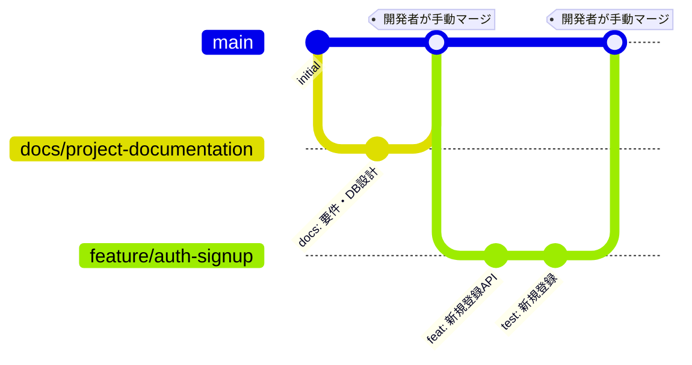

# TripDiary 開発ルール規約

| 項目 | 内容 |
| --- | --- |
| ドキュメント | 開発ルール規約 |
| バージョン | 0.1（初版ドラフト） |
| 作成日 | 2026-11-11 |
| 適用範囲 | TripDiary の開発に関わる全員（人間の開発者・AI エージェントを含む） |
| 関連資料 | [architecture.md](./architecture.md) / [qa_test_plan.md](./qa_test_plan.md) |

---

## 0. 最重要ルール（必読）

| # | ルール |
| --- | --- |
| 1 | 作業は必ずトピックブランチ（`feature/*`, `fix/*`, `docs/*` など）で行う。`main` / `develop` へ直接コミットしない |
| 2 | commit・push・Pull Request 作成までは行ってよい。**`main` / `develop` へのマージは開発者が内容を確認して手動で行う。** `git merge`、`gh pr merge`、GitHub の auto-merge は使用禁止 |
| 3 | 機能を実装したら、必ず単体テスト・結合テストを作成・実行し、オールグリーンを確認する。品質を開発スピードより優先する |
| 4 | **負荷テストは日々の CI で自動実行しない。** 全機能完成時に1回、手動トリガーでのみ実施する |
| 5 | Datadog 等の外部有償 APM は使用しない。ログは JSON 構造化ログ + MDC で追跡する |

---

## 1. Git / GitHub 運用

### 1.1 ブランチ戦略



| ブランチ | 用途 | 作成元 |
| --- | --- | --- |
| `main` | 常に動作する安定版。保護ブランチ | - |
| `develop` | （導入する場合）統合ブランチ。保護ブランチ | `main` |
| `feature/<機能名>` | 機能実装 | `main`（または `develop`） |
| `fix/<内容>` | 不具合修正 | 同上 |
| `docs/<内容>` | ドキュメント作成・更新 | 同上 |
| `chore/<内容>` | ビルド設定・依存更新・CI 等 | 同上 |
| `refactor/<内容>` | 振る舞いを変えないリファクタリング | 同上 |

- ブランチ名は英小文字・数字・ハイフン（例: `feature/spot-crud`, `fix/comment-xss`）。
- 1ブランチ = 1つの目的。大きな機能は機能ID単位（例: `feature/like`）に分割する。

### 1.2 コミットメッセージ（Conventional Commits）

```
<type>(<scope>): <概要（日本語可・50文字以内）>

<本文（任意）: 何を・なぜ変更したか>
```

| type | 用途 |
| --- | --- |
| `feat` | 機能追加 |
| `fix` | 不具合修正 |
| `test` | テストの追加・修正 |
| `docs` | ドキュメント |
| `refactor` | リファクタリング |
| `chore` | ビルド・依存・設定 |
| `ci` | CI 設定 |
| `perf` | 性能改善 |

例: `feat(spot): スポット投稿APIを追加`

### 1.3 Pull Request

- PR タイトルはコミットメッセージと同じ形式。
- PR 本文に以下を記載する:
  - 対応する機能ID（例: SPOT-01, SPOT-04）
  - 変更概要
  - テスト内容と実行結果（オールグリーンであること）
  - スクリーンショット（UI 変更時）
  - DB マイグレーションの有無
- CI がすべて成功するまでレビュー依頼しない。
- **レビュー・マージは開発者が行う。** 作成者（AI エージェントを含む）はマージしない。

### 1.4 ブランチ保護（GitHub 設定）

- `main`（および `develop`）: PR 必須、CI ステータスチェック成功必須、force push 禁止、auto-merge 無効。

---

## 2. コーディング規約

### 2.1 共通

- 文字コード UTF-8、改行 LF、インデントはスペース（Java: 4、TS/JSON/YAML: 2）。`.editorconfig` で統一する。
- 機密情報（パスワード、JWT 署名鍵、AWS キー）をソースコード・リポジトリに含めない。`.env` は `.gitignore` に入れ、`.env.example` のみコミットする。
- コメントは「なぜ」を書く。「何をしているか」はコードで表現する。
- TODO コメントには Issue 番号を付ける（例: `// TODO(#12): ...`）。

### 2.2 バックエンド（Java / Spring Boot）

| 項目 | ルール |
| --- | --- |
| フォーマット | Spotless（google-java-format の AOSP スタイル＝インデント4）で自動整形。`./gradlew spotlessApply` |
| パッケージ | 機能単位パッケージ（[architecture.md 3.2](./architecture.md#32-パッケージ構成機能単位パッケージ)） |
| 命名 | クラス `UpperCamelCase`、メソッド/変数 `lowerCamelCase`、定数 `UPPER_SNAKE_CASE` |
| DI | コンストラクタインジェクション（`@RequiredArgsConstructor` 可）。フィールドインジェクション禁止 |
| Controller | 薄く保つ。リクエスト DTO の検証（`@Valid`）とレスポンス変換のみ。Entity を直接返さない |
| Service | 業務ロジック・トランザクション境界（`@Transactional`）・所有者チェックを担う。参照系は `@Transactional(readOnly = true)` |
| DTO | Java `record` を使用 |
| 例外 | 業務例外は独自例外（`NotFoundException`, `ForbiddenException` 等）を投げ、`@RestControllerAdvice` で共通エラーレスポンスに変換 |
| JPA | 関連は `FetchType.LAZY`。`spring.jpa.open-in-view=false`。一覧取得は `@EntityGraph` / DTO プロジェクションで N+1 を回避 |
| 日時 | `Instant` / `OffsetDateTime` で扱い、DB は UTC。現在時刻は `Clock` を注入してテスト可能にする |
| Null | `Optional` は戻り値にのみ使用する |

### 2.3 フロントエンド（React / TypeScript）

| 項目 | ルール |
| --- | --- |
| フォーマット | oxlint + Prettier（`npm run lint` / `npm run format`）。`tsconfig` は `strict: true`。`src/components/ui`（shadcn/ui の生成物）は対象外 |
| 型 | `any` 禁止（やむを得ない場合は理由をコメント）。API 型は OpenAPI から生成した型を使う |
| コンポーネント | 関数コンポーネント + hooks。ファイル名は `PascalCase.tsx` |
| 構成 | 機能単位ディレクトリ（`src/features/<feature>`）。UI 部品は shadcn/ui をベースにする |
| データ取得 | TanStack Query を使用し、コンポーネント内で直接 `fetch` しない |
| スタイル | Tailwind CSS のユーティリティクラス。インライン `style` は原則禁止 |
| セキュリティ | `dangerouslySetInnerHTML` 禁止。ユーザー入力はテキストとして表示 |
| アクセシビリティ | 画像に `alt`、ボタンに識別可能なラベル、キーボード操作可能にする |

---

## 3. API 設計規約

| 項目 | ルール |
| --- | --- |
| ベースパス | `/api/v1` |
| URL | リソース名は複数形・kebab-case（例: `/spots/{id}/comments`, `/uploads/presigned-url`） |
| メソッド | GET 取得 / POST 作成 / PUT 置換・冪等な登録 / PATCH 部分更新 / DELETE 削除 |
| JSON | プロパティは `camelCase`。日時は ISO 8601（UTC, 例: `2026-11-11T03:15:42Z`） |
| ステータスコード | 200 / 201（作成, `Location` ヘッダ付き）/ 204 / 400 / 401 / 403 / 404 / 409 / 500 |
| エラー形式 | `{ "code": "SPOT_NOT_FOUND", "message": "...", "details": [{ "field": "title", "message": "..." }] }` |
| ページング | カーソル方式: `?cursor=...&limit=20`（最大50）。レスポンスに `nextCursor` を含める |

### 3.1 Swagger（OpenAPI 3.0）

- `springdoc-openapi-starter-webmvc-ui` を導入し、コントローラーのアノテーションから仕様を自動生成する。
  - Swagger UI: `/swagger-ui/index.html`
  - OpenAPI JSON: `/v3/api-docs`
- すべてのエンドポイントに以下を付与する:
  - `@Tag`（機能単位）、`@Operation(summary = ..., description = ...)`
  - `@ApiResponse`（正常系・主要エラー系のステータスとエラーコード）
  - DTO には `@Schema(description = ..., example = ...)`
- JWT 認証は `@SecurityScheme(type = HTTP, scheme = "bearer", bearerFormat = "JWT")` を定義し、Swagger UI の Authorize ボタンから試せるようにする。
- 本番環境では Swagger UI を無効化する（`springdoc.swagger-ui.enabled=false`、または認証で保護）。
- フロントエンドの API 型は `/v3/api-docs` から `openapi-typescript` 等で生成する。

---

## 4. データベース規約

- スキーマ変更は **Flyway マイグレーションのみ** で行う（`V{番号}__{内容}.sql`）。`ddl-auto` は `validate`。
- 適用済みのマイグレーションファイルは編集しない。修正は新しいバージョンで行う。
- 命名・型・制約は [database_schema.md](./database_schema.md) の設計方針に従う。
- スキーマ変更時は [database_schema.md](./database_schema.md) と [er_diagram.md](./er_diagram.md) を同じ PR で更新する。

---

## 5. ログ規約

### 5.1 基本方針

- Datadog などの有償 APM・外部ログサービスは使用しない。
- Logback と Spring Boot 標準の構造化ログ機能（`logging.structured.format.console=logstash`）を使用し、**本番（`prod` プロファイル）は JSON 形式で標準出力へ出力** する。MDC の値は自動で JSON に含まれる。ファイル出力はしない。
- ローカル（`local` プロファイル）は可読性重視のテキスト形式とする。
- ロガーは SLF4J（`@Slf4j` または `LoggerFactory.getLogger`）を使用し、`System.out.println` / `e.printStackTrace()` は禁止。
- メッセージはプレースホルダ（`log.info("Spot created: spotId={}", id)`）を使い、文字列連結しない。

### 5.2 ログレベルの使い分け

| レベル | 用途 | 例 |
| --- | --- | --- |
| `ERROR` | システムとして異常で、対応が必要なもの。**アラート対象** | 予期しない例外（500）、DB 接続失敗、S3 操作失敗 |
| `WARN` | 異常だがシステムは継続できるもの、要注視 | ログイン連続失敗・レート制限発動、リトライで回復した外部呼び出し、非推奨 API 使用 |
| `INFO` | 業務上の重要イベント・起動停止 | アプリ起動、ユーザー登録、スポット作成/削除、リクエスト完了（メソッド・パス・ステータス・処理時間） |
| `DEBUG` | 開発時の詳細情報。**本番では出力しない** | SQL、メソッドの入出力 |

- 400 系（バリデーションエラー・404・403 等）はクライアント起因のため `ERROR` にしない（`INFO` または `WARN`）。
- 例外を握りつぶさない。`ERROR` ログには例外オブジェクトを渡してスタックトレースを残す（`log.error("...", e)`）。
- 本番のルートログレベルは `INFO`。`org.hibernate.SQL` 等は `WARN` 以上。

### 5.3 MDC

| キー | 内容 | 付与箇所 |
| --- | --- | --- |
| `requestId` | リクエスト単位の追跡ID（`X-Request-Id` ヘッダを採用、なければ UUID 生成）。レスポンスヘッダにも返却 | `RequestIdFilter`（最優先 Filter） |
| `userId` | 認証済みユーザーID | JWT 認証成功後 |

- Filter の `finally` で必ず `MDC.clear()` する。
- 非同期処理（`@Async` 等）では `TaskDecorator` で MDC を引き継ぐ。
- フロントエンドはエラー表示時に `X-Request-Id` を表示 / 送信できるようにし、問い合わせ時の追跡に使う。

### 5.4 出力禁止情報

以下はログに出力してはならない（DTO の `toString()` にも含めない）:

- パスワード、パスワードハッシュ
- アクセストークン、リフレッシュトークン、`Authorization` ヘッダ
- S3 署名付きURL（署名クエリを含むため）
- メールアドレス等の個人情報（必要な場合は `userId` で代替）

---

## 6. テスト規約

詳細は [qa_test_plan.md](./qa_test_plan.md) を参照。

- **機能実装と同じ PR でテストを作成する。** テストのない機能 PR は作成しない。
- PR 作成前にローカルで全テストを実行し、オールグリーンを確認する。失敗したテストを `@Disabled` / `skip` で無効化して回避しない。
- テストメソッド名は振る舞いが分かる名前にする（例: `他人のスポットを削除すると403を返す`、または `deleteSpot_returns403_whenNotOwner`）。
- 1テスト1観点。Given / When / Then の構成で書く。
- 結合テストは Testcontainers の PostgreSQL を使用し、H2 等の代替 DB は使わない（本番との差異を防ぐ）。
- 外部サービス（S3）は S3Mock（Testcontainers）またはモックを使い、テストから実 AWS に接続しない。
- 不具合修正時は、先に不具合を再現する失敗テストを書いてから修正する。

---

## 7. CI/CD 規約

- CI は GitHub Actions を使用する。
- `ci.yml`: `pull_request` / `push` で Lint・単体テスト・結合テスト・E2E テストを自動実行する。
- `perf.yml`（負荷テスト）: **`workflow_dispatch` のみ。** `push` / `pull_request` / `schedule` トリガーの追加を禁止する。全機能完成時に1回のみ実施する。手順は [perf/README.md](../perf/README.md)。
- CI が失敗したら、原因を修正してから再 push する。CI を無効化・スキップ（`[skip ci]` 等）して回避しない。

---

## 8. セキュリティ規約

- 認可チェック（リソース所有者の確認）は Service 層で必ず行い、フロントエンドの表示制御だけに頼らない。
- 入力値は Bean Validation でサーバー側検証する。SQL は JPA / プリペアドステートメントのみ（文字列連結で SQL を組み立てない）。
- 依存ライブラリは Dependabot で更新を監視し、High 以上の脆弱性は速やかに対応する。
- フロントエンドの `npm audit` は、ブラウザに配信される本番用の依存（`npm audit --omit=dev`）を0件に保つ。ビルド時・開発時にしか使わない道具は `devDependencies` に置く。
  - `shadcn` はビルド時に `shadcn/tailwind.css` を取り込むのと、部品を追加する CLI にしか使わないため `devDependencies`。
  - CLI が使う ts-morph の minimatch は、修正版（11 系）が ts-morph の指定範囲外のため `package.json` の `overrides` で固定している（`npx shadcn add <部品> --dry-run` で CLI が動くことを確認済み）。ts-morph が 11 系に対応したら `overrides` を外す。
  - 既知の残件: `deepmerge`（low、shadcn CLI の依存）。修正には shadcn を 1.0 系に戻す必要があり、開発時の CLI でしか使われず配信物にも含まれないため対応しない。
- 秘密情報は AWS Secrets Manager / GitHub Actions Secrets で管理する。

---

## 9. ドキュメント規約

`docs/` 配下で以下を管理し、変更時は関連する実装と同じ PR で更新する。

| ファイル | 内容 |
| --- | --- |
| [requirements.md](./requirements.md) | 機能要件・非機能要件 |
| [database_schema.md](./database_schema.md) | テーブル定義・制約・DDL |
| [er_diagram.md](./er_diagram.md) | ER図（Mermaid） |
| [architecture.md](./architecture.md) | スキル図・アーキテクチャ図 |
| [qa_test_plan.md](./qa_test_plan.md) | 品質チェック・テスト計画 |
| [rules.md](./rules.md) | 本規約 |
| [features/](./features/README.md) | 機能別ドキュメント（ユースケース・画面・API・業務ルール・エラー・テスト観点） |
| [../README.md](../README.md) | プロジェクト概要・技術スタック・ドキュメント索引 |

- 図は Mermaid 記法で記述し、画像ファイルは極力使わない（差分管理のため）。
- API 仕様は Swagger（自動生成）を正とし、Markdown に二重管理しない。
